<!-- GENERATED SHOWCASE:BEGIN -->

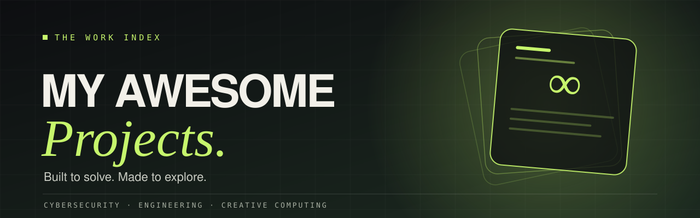

<strong>A curated archive of software, security tooling, product experiments and creative computing.</strong>

<a href="https://itssourov13.github.io/my-awesome-projects/"><strong>Interactive showcase ↗</strong></a> &nbsp;·&nbsp; <a href="https://github.com/itssourov13">GitHub profile ↗</a>

<a href="#popular">Popular</a> &nbsp;·&nbsp; <a href="#selected-work">Selected work</a> &nbsp;·&nbsp; <a href="#the-archive">The archive</a> &nbsp;·&nbsp; <a href="#source-privacy--live-preview-policy">Source &amp; preview policy</a>

<table>
<tr>
<td align="center" width="25%"><strong>33</strong> PROJECTS</td>
<td align="center" width="25%"><strong>8</strong> DISCIPLINES</td>
<td align="center" width="25%"><strong>32</strong> PUBLIC SOURCES</td>
<td align="center" width="25%"><strong>15</strong> LIVE PREVIEWS</td>
</tr>
</table>

> Covers are portfolio artwork, not claims that every project is production-ready, and not always real UI screenshots. A **live preview** and a **public source** are separate things: each link appears only when it has been approved for public visitors.

## Popular

<table width="100%">
<tr>
<td width="50%" valign="top"><h3><a href="https://github.com/itssourov13/passhunter">PassHunter</a></h3>
A deterministic password-pattern candidate generator for authorized security assessments, CTFs, and lab research.

<code>Python</code> <code>CLI</code> <code>Standard library</code>

Active development <a href="https://github.com/itssourov13/passhunter">Public source ↗</a>
</td>
<td width="50%" valign="top"><h3><a href="https://scholarhub-itssourov13.vercel.app/">ScholarHub</a></h3>
A scholarship discovery and application-management platform designed to help students find opportunities and manage application progress.

<code>TypeScript</code> <code>Web</code>

Live preview listed <a href="https://scholarhub-itssourov13.vercel.app/"><strong>Live preview ↗</strong></a>
</td>
</tr>
<tr>
<td width="50%" align="right" valign="middle">

</td>
<td width="50%" align="right" valign="middle">

</td>
</tr>
</table>

## Selected work

<table width="100%">
<tr>
<td width="58%" valign="middle"><a href="https://sourovworks-itssourov13.vercel.app/">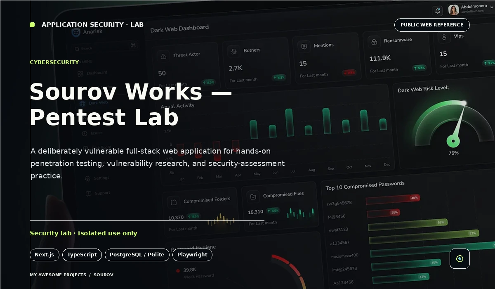</a></td>
<td width="42%" valign="middle"><strong>APPLICATION SECURITY · LAB</strong><h3><a href="https://sourovworks-itssourov13.vercel.app/">Sourov Works — Pentest Lab</a></h3>
A deliberately vulnerable full-stack web application for hands-on penetration testing, vulnerability research, and security-assessment practice.

<code>Next.js</code> <code>TypeScript</code> <code>PostgreSQL / PGlite</code> <code>Playwright</code>

Security lab · isolated use only <a href="https://sourovworks-itssourov13.vercel.app/"><strong>Live preview ↗</strong></a> &nbsp;·&nbsp; <a href="https://github.com/itssourov13/personal-website-pentest">Public source ↗</a>
</td>
</tr>
</table>

<table width="100%">
<tr>
<td width="50%" valign="top"><a href="https://scholarhub-itssourov13.vercel.app/">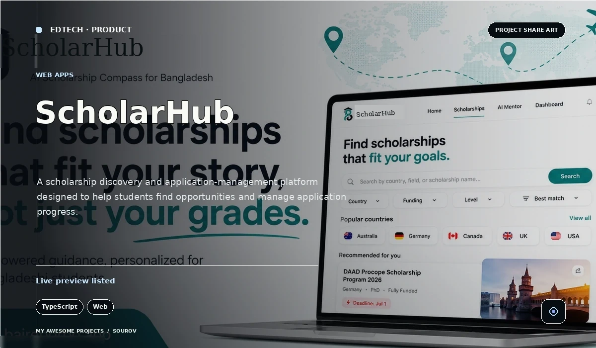</a> <strong>EDTECH · PRODUCT</strong><h3><a href="https://scholarhub-itssourov13.vercel.app/">ScholarHub</a></h3>
A scholarship discovery and application-management platform designed to help students find opportunities and manage application progress.

<code>TypeScript</code> <code>Web</code>

Live preview listed <a href="https://scholarhub-itssourov13.vercel.app/"><strong>Live preview ↗</strong></a> &nbsp;·&nbsp; <em>Source hidden</em>
</td>
<td width="50%" valign="top"><a href="https://demo-website-itssourov13.vercel.app/">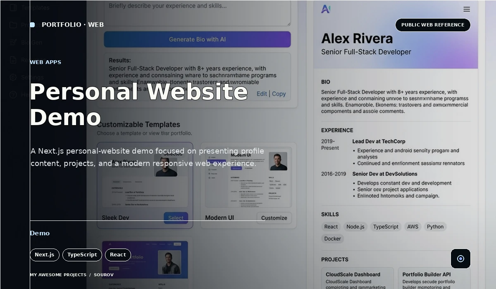</a> <strong>PORTFOLIO · WEB</strong><h3><a href="https://demo-website-itssourov13.vercel.app/">Personal Website Demo</a></h3>
A Next.js personal-website demo focused on presenting profile content, projects, and a modern responsive web experience.

<code>Next.js</code> <code>TypeScript</code> <code>React</code>

Demo <a href="https://demo-website-itssourov13.vercel.app/"><strong>Live preview ↗</strong></a> &nbsp;·&nbsp; <a href="https://github.com/itssourov13/personal-website-test">Public source ↗</a>
</td>
</tr>
<tr>
<td width="50%" valign="top"><a href="https://kaven-itssourov13.vercel.app/">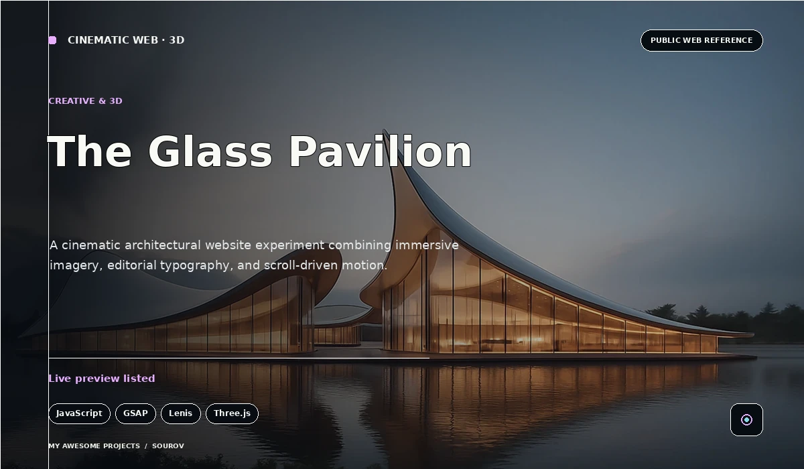</a> <strong>CINEMATIC WEB · 3D</strong><h3><a href="https://kaven-itssourov13.vercel.app/">The Glass Pavilion</a></h3>
A cinematic architectural website experiment combining immersive imagery, editorial typography, and scroll-driven motion.

<code>JavaScript</code> <code>GSAP</code> <code>Lenis</code> <code>Three.js</code>

Live preview listed <a href="https://kaven-itssourov13.vercel.app/"><strong>Live preview ↗</strong></a> &nbsp;·&nbsp; <a href="https://github.com/itssourov13/cinematic-architecture-web">Public source ↗</a>
</td>
<td width="50%" valign="top"><a href="https://blog-itssourov13.vercel.app">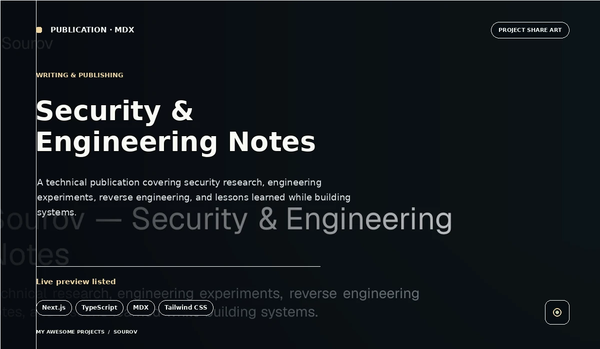</a> <strong>PUBLICATION · MDX</strong><h3><a href="https://blog-itssourov13.vercel.app">Security &amp; Engineering Notes</a></h3>
A technical publication covering security research, engineering experiments, reverse engineering, and lessons learned while building systems.

<code>Next.js</code> <code>TypeScript</code> <code>MDX</code> <code>Tailwind CSS</code>

Live preview listed <a href="https://blog-itssourov13.vercel.app"><strong>Live preview ↗</strong></a> &nbsp;·&nbsp; <a href="https://github.com/itssourov13/blog">Public source ↗</a>
</td>
</tr>
<tr>
<td width="50%" valign="top"><a href="https://sketchbook-itssourov13.vercel.app/">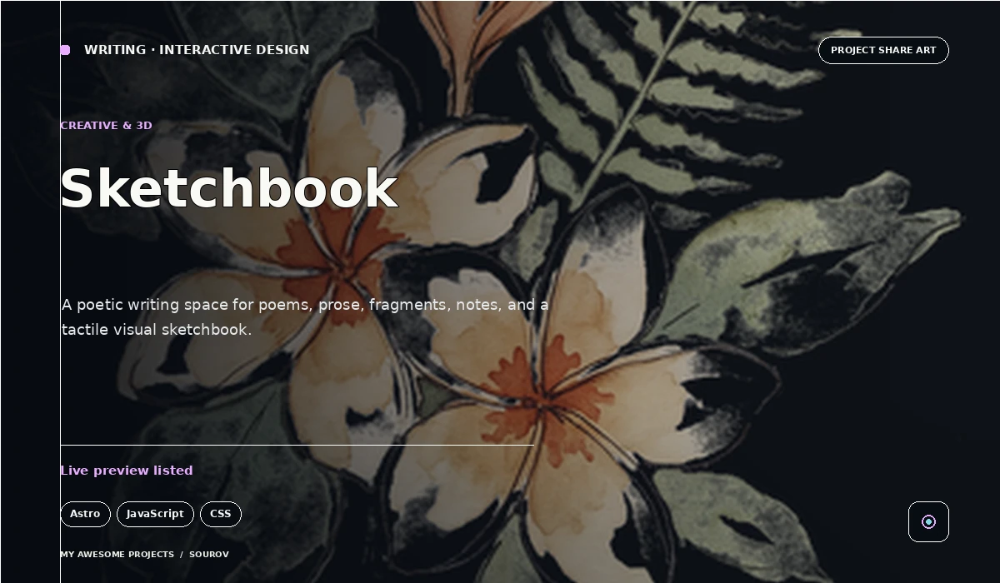</a> <strong>WRITING · INTERACTIVE DESIGN</strong><h3><a href="https://sketchbook-itssourov13.vercel.app/">Sketchbook</a></h3>
A poetic writing space for poems, prose, fragments, notes, and a tactile visual sketchbook.

<code>Astro</code> <code>JavaScript</code> <code>CSS</code>

Live preview listed <a href="https://sketchbook-itssourov13.vercel.app/"><strong>Live preview ↗</strong></a> &nbsp;·&nbsp; <a href="https://github.com/itssourov13/sketchbook">Public source ↗</a>
</td>
<td width="50%" valign="top"><a href="https://arven-itssourov13.vercel.app/">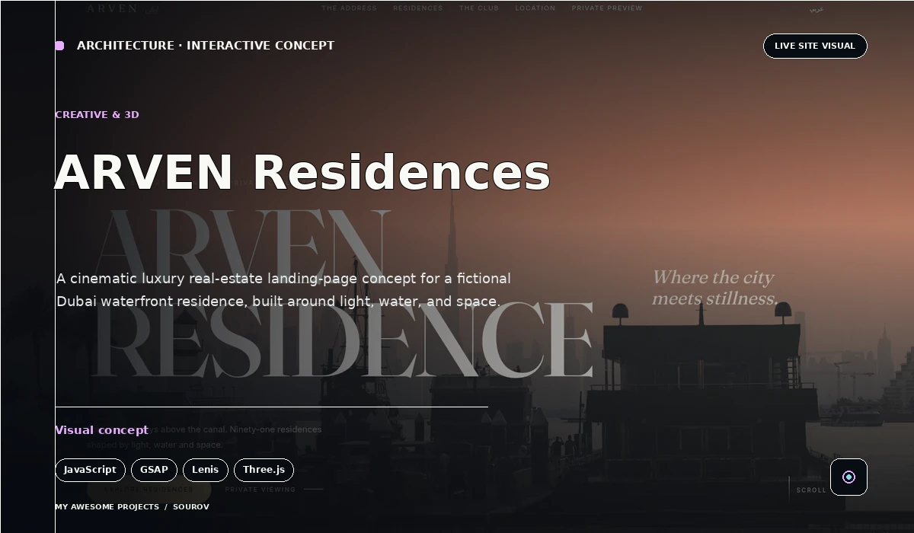</a> <strong>ARCHITECTURE · INTERACTIVE CONCEPT</strong><h3><a href="https://arven-itssourov13.vercel.app/">ARVEN Residences</a></h3>
A cinematic luxury real-estate landing-page concept for a fictional Dubai waterfront residence, built around light, water, and space.

<code>JavaScript</code> <code>GSAP</code> <code>Lenis</code> <code>Three.js</code>

Visual concept <a href="https://arven-itssourov13.vercel.app/"><strong>Live preview ↗</strong></a> &nbsp;·&nbsp; <a href="https://github.com/itssourov13/arven">Public source ↗</a>
</td>
</tr>
</table>

## The archive

<a href="#cybersecurity">Cybersecurity</a>&nbsp;8 &nbsp;·&nbsp; <a href="#ai--developer-tools">AI &amp; Developer Tools</a>&nbsp;4 &nbsp;·&nbsp; <a href="#web-apps">Web Apps</a>&nbsp;5 &nbsp;·&nbsp; <a href="#creative--3d">Creative &amp; 3D</a>&nbsp;6 &nbsp;·&nbsp; <a href="#mobile-apps">Mobile Apps</a>&nbsp;2 &nbsp;·&nbsp; <a href="#utilities">Utilities</a>&nbsp;4 &nbsp;·&nbsp; <a href="#writing--publishing">Writing &amp; Publishing</a>&nbsp;1 &nbsp;·&nbsp; <a href="#open-source">Open Source</a>&nbsp;3

★ marks a project also shown in Selected work. 33 projects in total, 1 with source hidden. Latest recorded catalog update: 2026-10-30.

### Cybersecurity

8 projects &nbsp;·&nbsp; <a href="#the-archive">Back to archive index ↑</a>

<table width="100%">
<tr>
<td width="190" valign="top"><a href="https://github.com/itssourov13/apk-sherlock">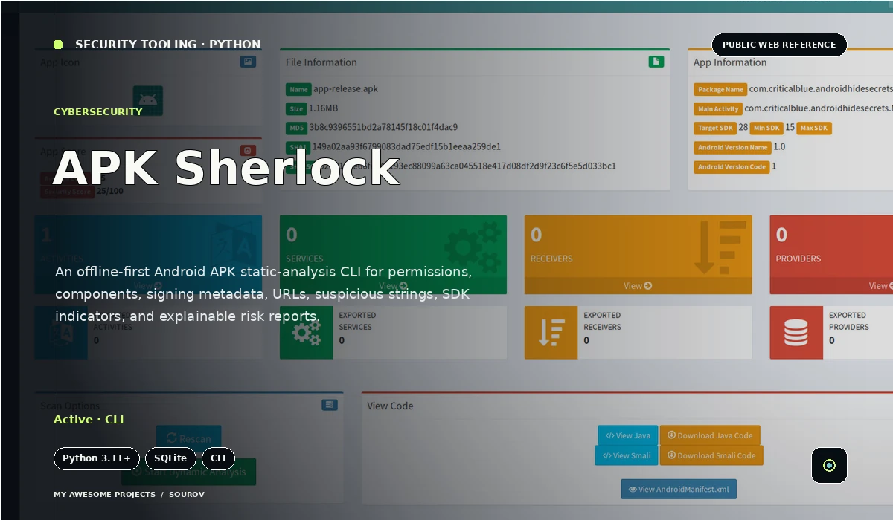</a></td>
<td valign="top"><strong><a href="https://github.com/itssourov13/apk-sherlock">APK Sherlock</a></strong> Active · CLI An offline-first Android APK static-analysis CLI for permissions, components, signing metadata, URLs, suspicious strings, SDK indicators, and explainable risk reports. <code>Python 3.11+</code> <code>SQLite</code> <code>CLI</code> <a href="https://github.com/itssourov13/apk-sherlock">Public source ↗</a></td>
</tr>
<tr>
<td width="190" valign="top"><a href="https://github.com/itssourov13/ares">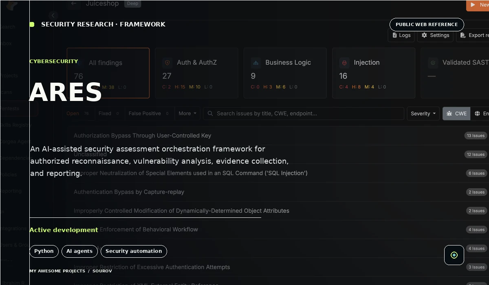</a></td>
<td valign="top"><strong><a href="https://github.com/itssourov13/ares">ARES</a></strong> Active development An AI-assisted security assessment orchestration framework for authorized reconnaissance, vulnerability analysis, evidence collection, and reporting. <code>Python</code> <code>AI agents</code> <code>Security automation</code> <a href="https://github.com/itssourov13/ares">Public source ↗</a></td>
</tr>
<tr>
<td width="190" valign="top"><a href="https://github.com/itssourov13/cyberos">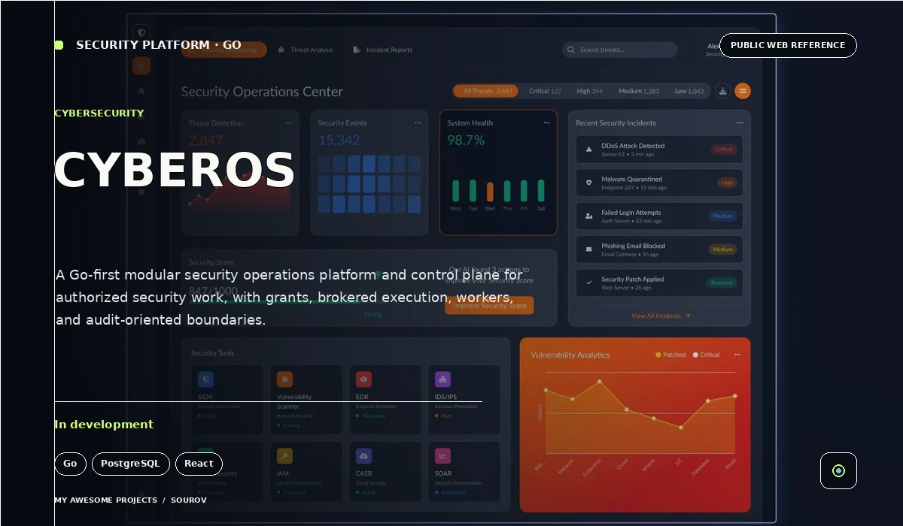</a></td>
<td valign="top"><strong><a href="https://github.com/itssourov13/cyberos">CYBEROS</a></strong> In development A Go-first modular security operations platform and control plane for authorized security work, with grants, brokered execution, workers, and audit-oriented boundaries. <code>Go</code> <code>PostgreSQL</code> <code>React</code> <a href="https://github.com/itssourov13/cyberos">Public source ↗</a></td>
</tr>
<tr>
<td width="190" valign="top"><a href="https://onyx-xi-three.vercel.app">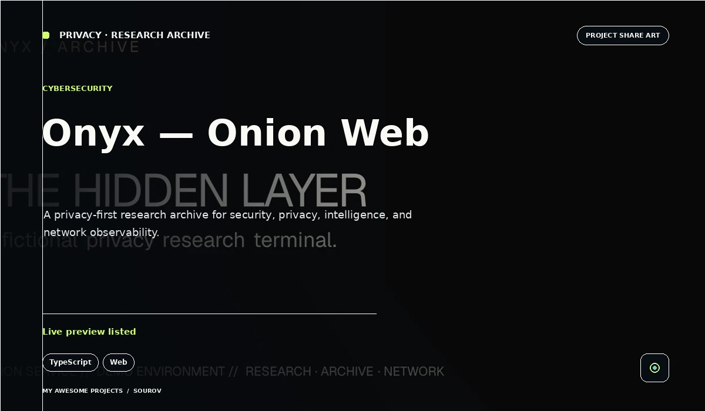</a></td>
<td valign="top"><strong><a href="https://onyx-xi-three.vercel.app">Onyx — Onion Web</a></strong> Live preview listed A privacy-first research archive for security, privacy, intelligence, and network observability. <code>TypeScript</code> <code>Web</code> <a href="https://onyx-xi-three.vercel.app"><strong>Live preview ↗</strong></a> &nbsp;·&nbsp; <a href="https://github.com/itssourov13/onyx">Public source ↗</a></td>
</tr>
<tr>
<td width="190" valign="top"><a href="https://github.com/itssourov13/passhunter">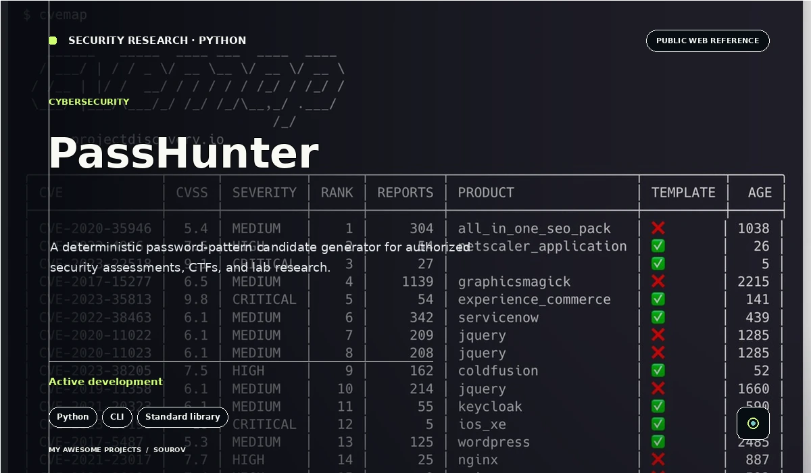</a></td>
<td valign="top"><strong><a href="https://github.com/itssourov13/passhunter">PassHunter</a></strong> Active development A deterministic password-pattern candidate generator for authorized security assessments, CTFs, and lab research. <code>Python</code> <code>CLI</code> <code>Standard library</code> <a href="https://github.com/itssourov13/passhunter">Public source ↗</a></td>
</tr>
<tr>
<td width="190" valign="top"></td>
<td valign="top"><strong><a href="https://sourovworks-itssourov13.vercel.app/">Sourov Works — Pentest Lab</a></strong> ★ Security lab · isolated use only A deliberately vulnerable full-stack web application for hands-on penetration testing, vulnerability research, and security-assessment practice. <code>Next.js</code> <code>TypeScript</code> <code>PostgreSQL / PGlite</code> <code>Playwright</code> <a href="https://sourovworks-itssourov13.vercel.app/"><strong>Live preview ↗</strong></a> &nbsp;·&nbsp; <a href="https://github.com/itssourov13/personal-website-pentest">Public source ↗</a></td>
</tr>
<tr>
<td width="190" valign="top"><a href="https://github.com/itssourov13/VercelStrike">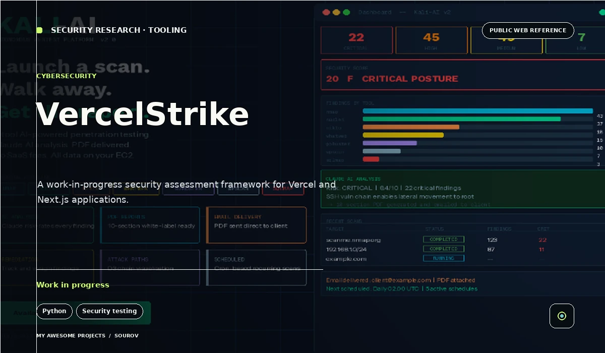</a></td>
<td valign="top"><strong><a href="https://github.com/itssourov13/VercelStrike">VercelStrike</a></strong> Work in progress A work-in-progress security assessment framework for Vercel and Next.js applications. <code>Python</code> <code>Security testing</code> <a href="https://github.com/itssourov13/VercelStrike">Public source ↗</a></td>
</tr>
<tr>
<td width="190" valign="top"><a href="https://github.com/itssourov13/VercStorm">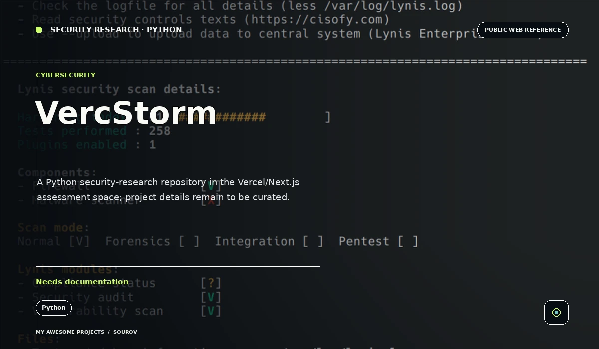</a></td>
<td valign="top"><strong><a href="https://github.com/itssourov13/VercStorm">VercStorm</a></strong> Needs documentation A Python security-research repository in the Vercel/Next.js assessment space; project details remain to be curated. <code>Python</code> <a href="https://github.com/itssourov13/VercStorm">Public source ↗</a></td>
</tr>
</table>

### AI & Developer Tools

4 projects &nbsp;·&nbsp; <a href="#the-archive">Back to archive index ↑</a>

<table width="100%">
<tr>
<td width="190" valign="top"><a href="https://hackergf-ai.vercel.app">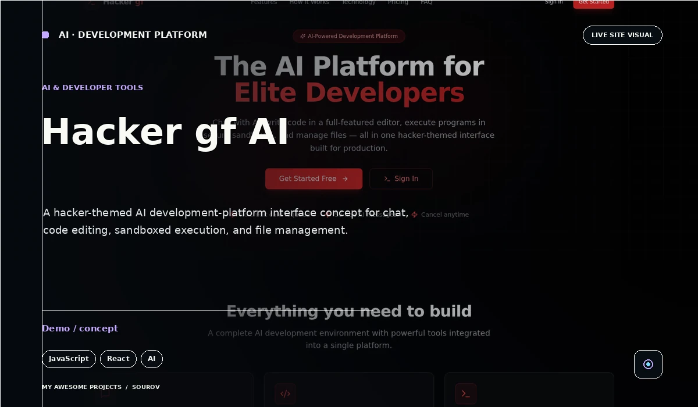</a></td>
<td valign="top"><strong><a href="https://hackergf-ai.vercel.app">Hacker gf AI</a></strong> Demo / concept A hacker-themed AI development-platform interface concept for chat, code editing, sandboxed execution, and file management. <code>JavaScript</code> <code>React</code> <code>AI</code> <a href="https://hackergf-ai.vercel.app"><strong>Live preview ↗</strong></a> &nbsp;·&nbsp; <a href="https://github.com/itssourov13/hackergf-ai">Public source ↗</a></td>
</tr>
<tr>
<td width="190" valign="top"><a href="https://github.com/itssourov13/hackerai-main">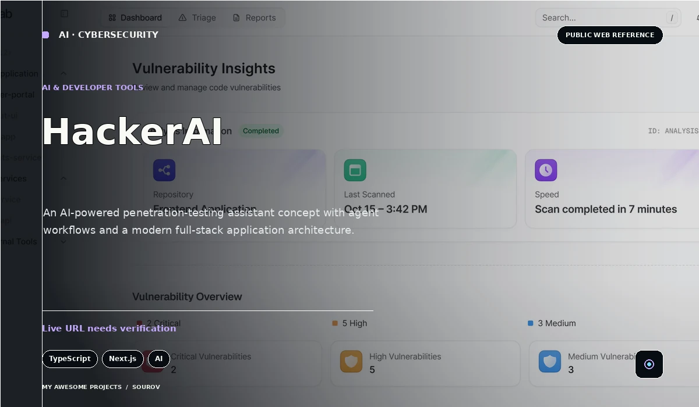</a></td>
<td valign="top"><strong><a href="https://github.com/itssourov13/hackerai-main">HackerAI</a></strong> Live URL needs verification An AI-powered penetration-testing assistant concept with agent workflows and a modern full-stack application architecture. <code>TypeScript</code> <code>Next.js</code> <code>AI</code> <a href="https://github.com/itssourov13/hackerai-main">Public source ↗</a></td>
</tr>
<tr>
<td width="190" valign="top"><a href="https://github.com/itssourov13/hackerai-base44">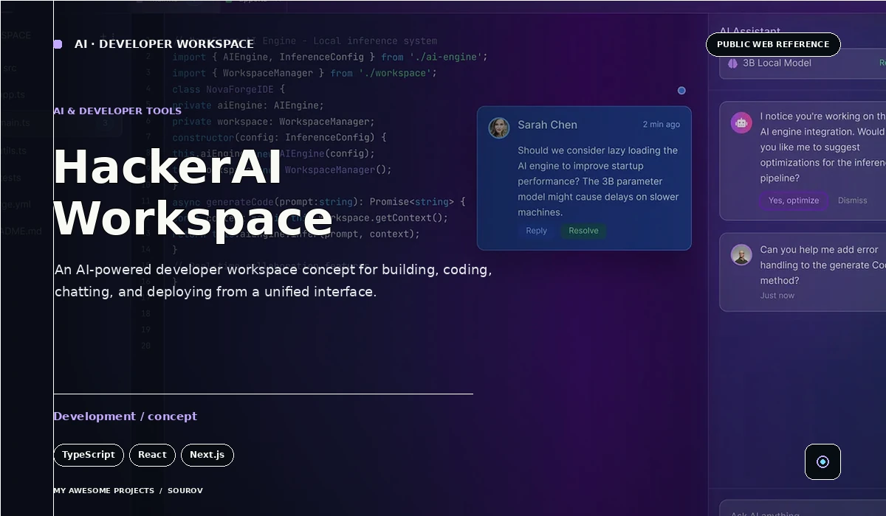</a></td>
<td valign="top"><strong><a href="https://github.com/itssourov13/hackerai-base44">HackerAI Workspace</a></strong> Development / concept An AI-powered developer workspace concept for building, coding, chatting, and deploying from a unified interface. <code>TypeScript</code> <code>React</code> <code>Next.js</code> <a href="https://github.com/itssourov13/hackerai-base44">Public source ↗</a></td>
</tr>
<tr>
<td width="190" valign="top"><a href="https://github.com/itssourov13/uab">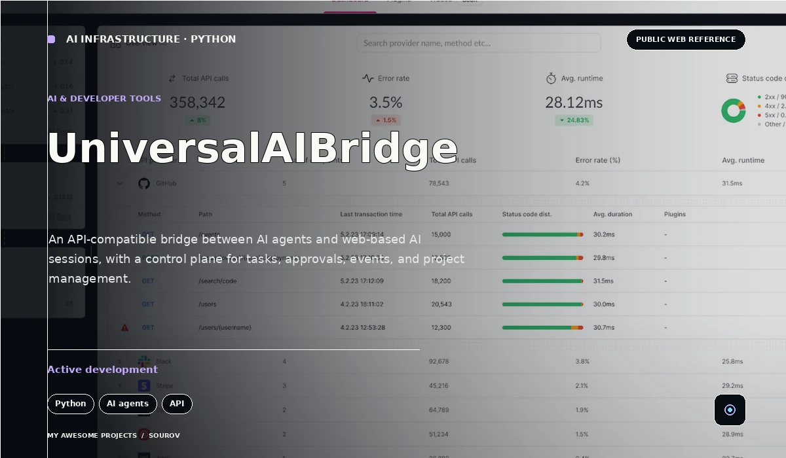</a></td>
<td valign="top"><strong><a href="https://github.com/itssourov13/uab">UniversalAIBridge</a></strong> Active development An API-compatible bridge between AI agents and web-based AI sessions, with a control plane for tasks, approvals, events, and project management. <code>Python</code> <code>AI agents</code> <code>API</code> <a href="https://github.com/itssourov13/uab">Public source ↗</a></td>
</tr>
</table>

### Web Apps

5 projects &nbsp;·&nbsp; <a href="#the-archive">Back to archive index ↑</a>

<table width="100%">
<tr>
<td width="190" valign="top"><a href="https://birthday-present-itssourov13.vercel.app/">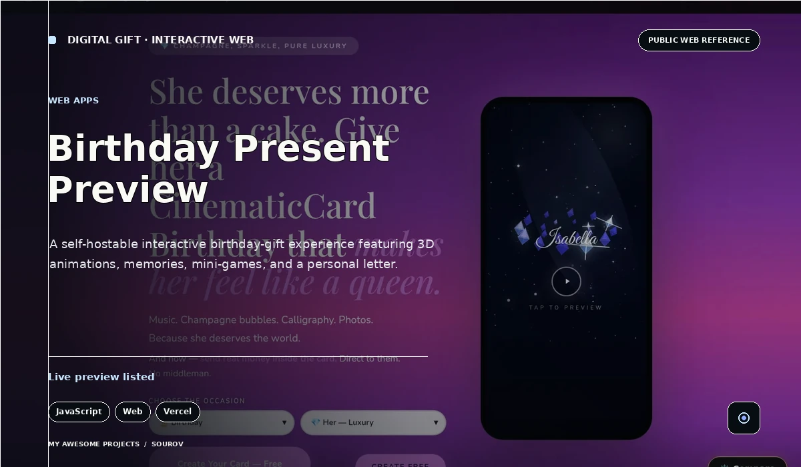</a></td>
<td valign="top"><strong><a href="https://birthday-present-itssourov13.vercel.app/">Birthday Present Preview</a></strong> Live preview listed A self-hostable interactive birthday-gift experience featuring 3D animations, memories, mini-games, and a personal letter. <code>JavaScript</code> <code>Web</code> <code>Vercel</code> <a href="https://birthday-present-itssourov13.vercel.app/"><strong>Live preview ↗</strong></a> &nbsp;·&nbsp; <a href="https://github.com/itssourov13/birthday-present-preview">Public source ↗</a></td>
</tr>
<tr>
<td width="190" valign="top"><a href="https://cgw-itssourov13.vercel.app">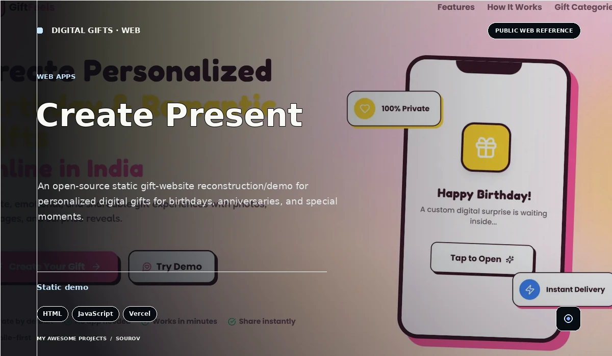</a></td>
<td valign="top"><strong><a href="https://cgw-itssourov13.vercel.app">Create Present</a></strong> Static demo An open-source static gift-website reconstruction/demo for personalized digital gifts for birthdays, anniversaries, and special moments. <code>HTML</code> <code>JavaScript</code> <code>Vercel</code> <a href="https://cgw-itssourov13.vercel.app"><strong>Live preview ↗</strong></a> &nbsp;·&nbsp; <a href="https://github.com/itssourov13/create-present-website">Public source ↗</a></td>
</tr>
<tr>
<td width="190" valign="top"></td>
<td valign="top"><strong><a href="https://demo-website-itssourov13.vercel.app/">Personal Website Demo</a></strong> ★ Demo A Next.js personal-website demo focused on presenting profile content, projects, and a modern responsive web experience. <code>Next.js</code> <code>TypeScript</code> <code>React</code> <a href="https://demo-website-itssourov13.vercel.app/"><strong>Live preview ↗</strong></a> &nbsp;·&nbsp; <a href="https://github.com/itssourov13/personal-website-test">Public source ↗</a></td>
</tr>
<tr>
<td width="190" valign="top"><a href="https://claude-personal-web-itssourov13.vercel.app/">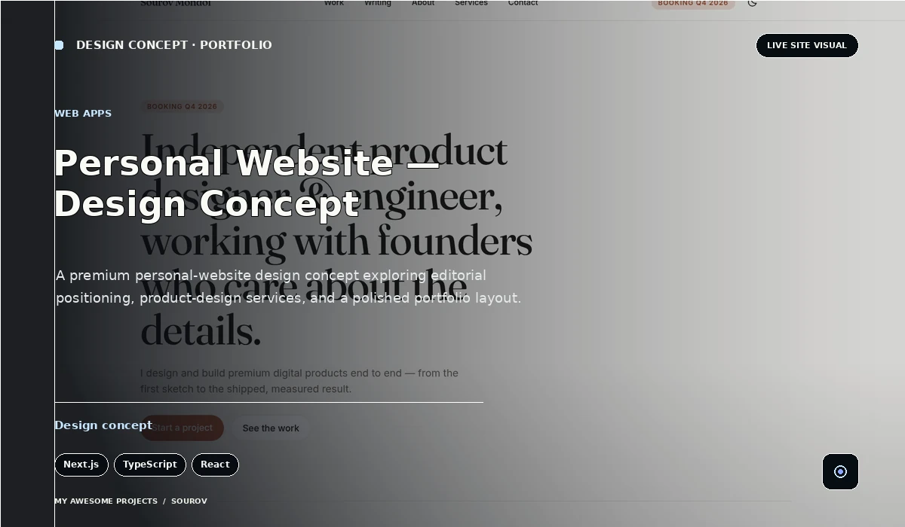</a></td>
<td valign="top"><strong><a href="https://claude-personal-web-itssourov13.vercel.app/">Personal Website — Design Concept</a></strong> Design concept A premium personal-website design concept exploring editorial positioning, product-design services, and a polished portfolio layout. <code>Next.js</code> <code>TypeScript</code> <code>React</code> <a href="https://claude-personal-web-itssourov13.vercel.app/"><strong>Live preview ↗</strong></a> &nbsp;·&nbsp; <a href="https://github.com/itssourov13/claude-personal-website">Public source ↗</a></td>
</tr>
<tr>
<td width="190" valign="top"></td>
<td valign="top"><strong><a href="https://scholarhub-itssourov13.vercel.app/">ScholarHub</a></strong> ★ Live preview listed A scholarship discovery and application-management platform designed to help students find opportunities and manage application progress. <code>TypeScript</code> <code>Web</code> <a href="https://scholarhub-itssourov13.vercel.app/"><strong>Live preview ↗</strong></a> &nbsp;·&nbsp; <em>Source hidden</em></td>
</tr>
</table>

### Creative & 3D

6 projects &nbsp;·&nbsp; <a href="#the-archive">Back to archive index ↑</a>

<table width="100%">
<tr>
<td width="190" valign="top"><a href="https://github.com/itssourov13/active-theory">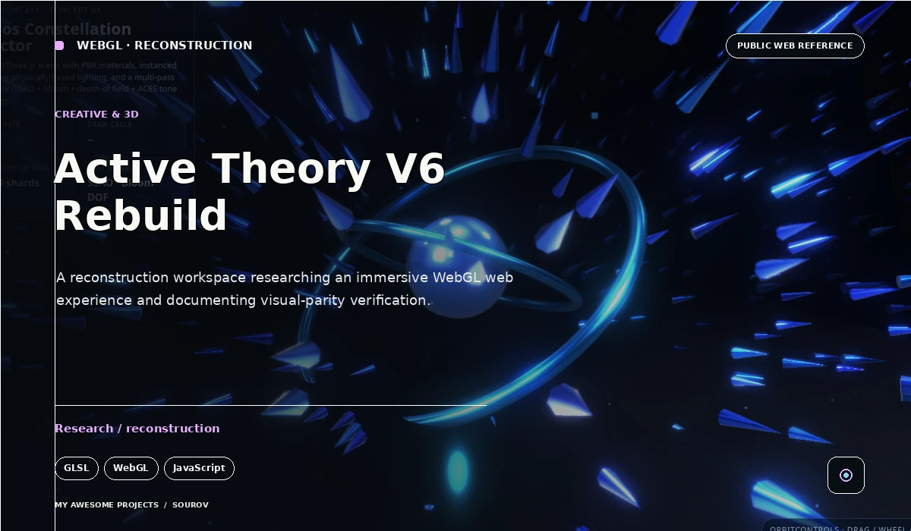</a></td>
<td valign="top"><strong><a href="https://github.com/itssourov13/active-theory">Active Theory V6 Rebuild</a></strong> Research / reconstruction A reconstruction workspace researching an immersive WebGL web experience and documenting visual-parity verification. <code>GLSL</code> <code>WebGL</code> <code>JavaScript</code> <a href="https://github.com/itssourov13/active-theory">Public source ↗</a></td>
</tr>
<tr>
<td width="190" valign="top"></td>
<td valign="top"><strong><a href="https://arven-itssourov13.vercel.app/">ARVEN Residences</a></strong> ★ Visual concept A cinematic luxury real-estate landing-page concept for a fictional Dubai waterfront residence, built around light, water, and space. <code>JavaScript</code> <code>GSAP</code> <code>Lenis</code> <code>Three.js</code> <a href="https://arven-itssourov13.vercel.app/"><strong>Live preview ↗</strong></a> &nbsp;·&nbsp; <a href="https://github.com/itssourov13/arven">Public source ↗</a></td>
</tr>
<tr>
<td width="190" valign="top"><a href="https://github.com/itssourov13/rise-of-ai">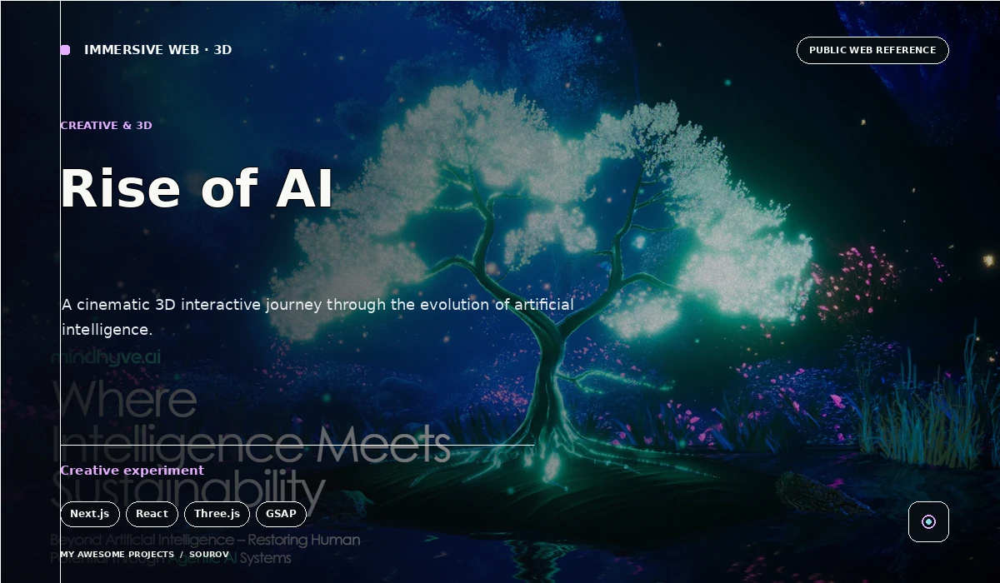</a></td>
<td valign="top"><strong><a href="https://github.com/itssourov13/rise-of-ai">Rise of AI</a></strong> Creative experiment A cinematic 3D interactive journey through the evolution of artificial intelligence. <code>Next.js</code> <code>React</code> <code>Three.js</code> <code>GSAP</code> <a href="https://github.com/itssourov13/rise-of-ai">Public source ↗</a></td>
</tr>
<tr>
<td width="190" valign="top"></td>
<td valign="top"><strong><a href="https://sketchbook-itssourov13.vercel.app/">Sketchbook</a></strong> ★ Live preview listed A poetic writing space for poems, prose, fragments, notes, and a tactile visual sketchbook. <code>Astro</code> <code>JavaScript</code> <code>CSS</code> <a href="https://sketchbook-itssourov13.vercel.app/"><strong>Live preview ↗</strong></a> &nbsp;·&nbsp; <a href="https://github.com/itssourov13/sketchbook">Public source ↗</a></td>
</tr>
<tr>
<td width="190" valign="top"><a href="https://stele-residences-itssourov13.vercel.app">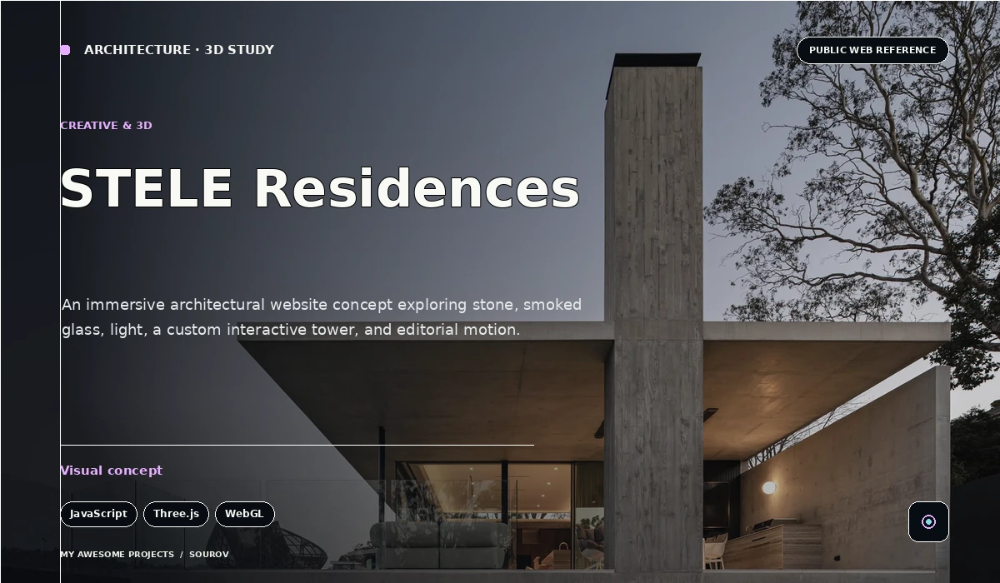</a></td>
<td valign="top"><strong><a href="https://stele-residences-itssourov13.vercel.app">STELE Residences</a></strong> Visual concept An immersive architectural website concept exploring stone, smoked glass, light, a custom interactive tower, and editorial motion. <code>JavaScript</code> <code>Three.js</code> <code>WebGL</code> <a href="https://stele-residences-itssourov13.vercel.app"><strong>Live preview ↗</strong></a> &nbsp;·&nbsp; <a href="https://github.com/itssourov13/stele-residences">Public source ↗</a></td>
</tr>
<tr>
<td width="190" valign="top"></td>
<td valign="top"><strong><a href="https://kaven-itssourov13.vercel.app/">The Glass Pavilion</a></strong> ★ Live preview listed A cinematic architectural website experiment combining immersive imagery, editorial typography, and scroll-driven motion. <code>JavaScript</code> <code>GSAP</code> <code>Lenis</code> <code>Three.js</code> <a href="https://kaven-itssourov13.vercel.app/"><strong>Live preview ↗</strong></a> &nbsp;·&nbsp; <a href="https://github.com/itssourov13/cinematic-architecture-web">Public source ↗</a></td>
</tr>
</table>

### Mobile Apps

2 projects &nbsp;·&nbsp; <a href="#the-archive">Back to archive index ↑</a>

<table width="100%">
<tr>
<td width="190" valign="top"><a href="https://github.com/itssourov13/bd-admission-app">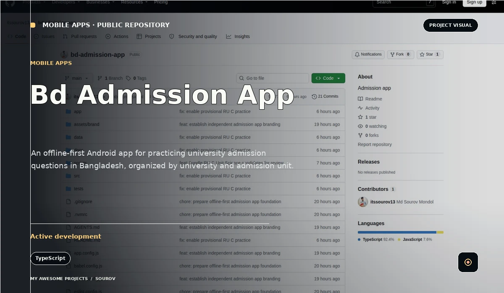</a></td>
<td valign="top"><strong><a href="https://github.com/itssourov13/bd-admission-app">Bd Admission App</a></strong> Active development An offline-first Android app for practicing university admission questions in Bangladesh, organized by university and admission unit. <code>TypeScript</code> <a href="https://github.com/itssourov13/bd-admission-app">Public source ↗</a></td>
</tr>
<tr>
<td width="190" valign="top"><a href="https://github.com/itssourov13/study-planner-apk">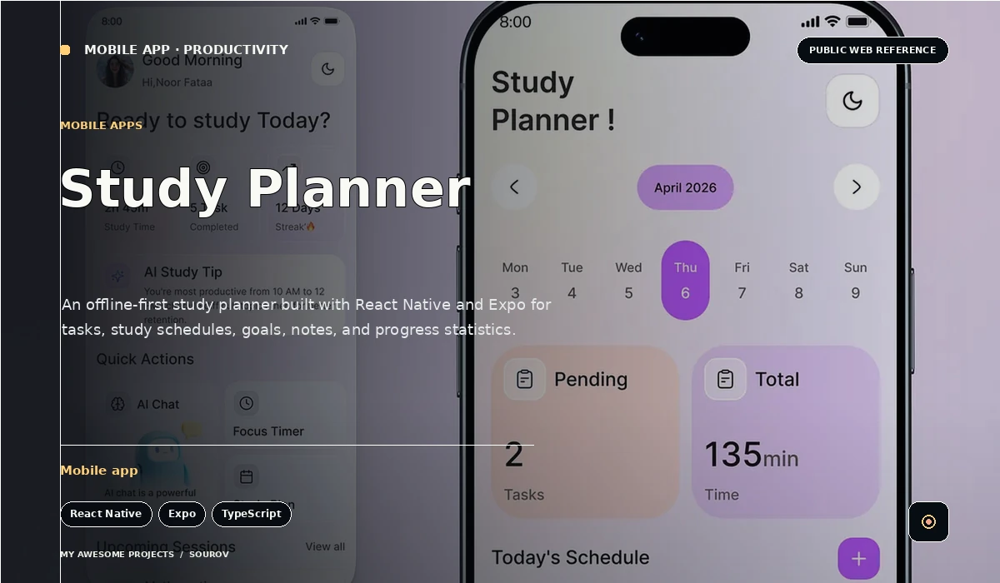</a></td>
<td valign="top"><strong><a href="https://github.com/itssourov13/study-planner-apk">Study Planner</a></strong> Mobile app An offline-first study planner built with React Native and Expo for tasks, study schedules, goals, notes, and progress statistics. <code>React Native</code> <code>Expo</code> <code>TypeScript</code> <a href="https://github.com/itssourov13/study-planner-apk">Public source ↗</a></td>
</tr>
</table>

### Utilities

4 projects &nbsp;·&nbsp; <a href="#the-archive">Back to archive index ↑</a>

<table width="100%">
<tr>
<td width="190" valign="top"><a href="https://github.com/itssourov13/Employee-profile-generator">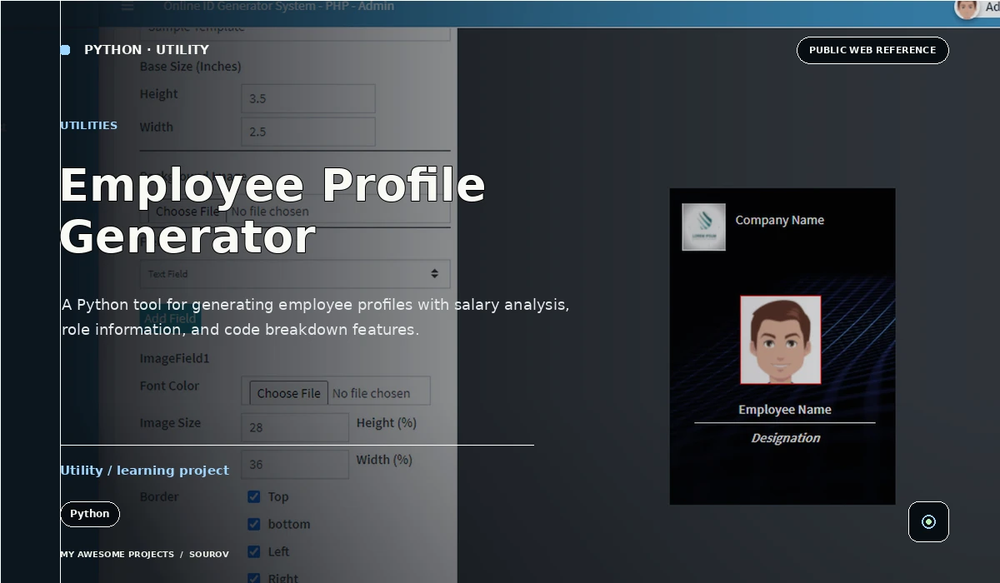</a></td>
<td valign="top"><strong><a href="https://github.com/itssourov13/Employee-profile-generator">Employee Profile Generator</a></strong> Utility / learning project A Python tool for generating employee profiles with salary analysis, role information, and code breakdown features. <code>Python</code> <a href="https://github.com/itssourov13/Employee-profile-generator">Public source ↗</a></td>
</tr>
<tr>
<td width="190" valign="top"><a href="https://github.com/itssourov13/Movie-Ticket-Booking-Calculator-Python-">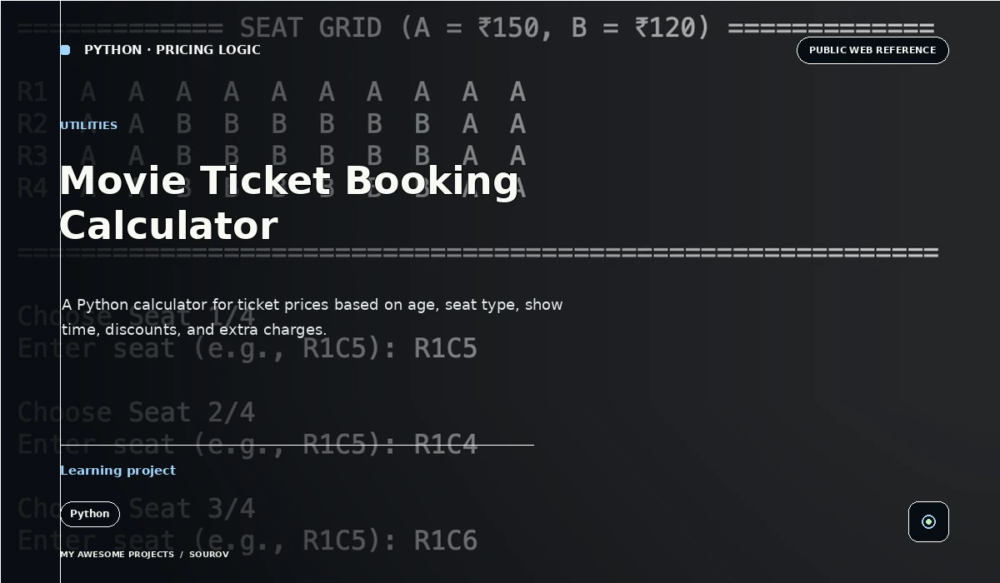</a></td>
<td valign="top"><strong><a href="https://github.com/itssourov13/Movie-Ticket-Booking-Calculator-Python-">Movie Ticket Booking Calculator</a></strong> Learning project A Python calculator for ticket prices based on age, seat type, show time, discounts, and extra charges. <code>Python</code> <a href="https://github.com/itssourov13/Movie-Ticket-Booking-Calculator-Python-">Public source ↗</a></td>
</tr>
<tr>
<td width="190" valign="top"><a href="https://github.com/itssourov13/Report-card-printer">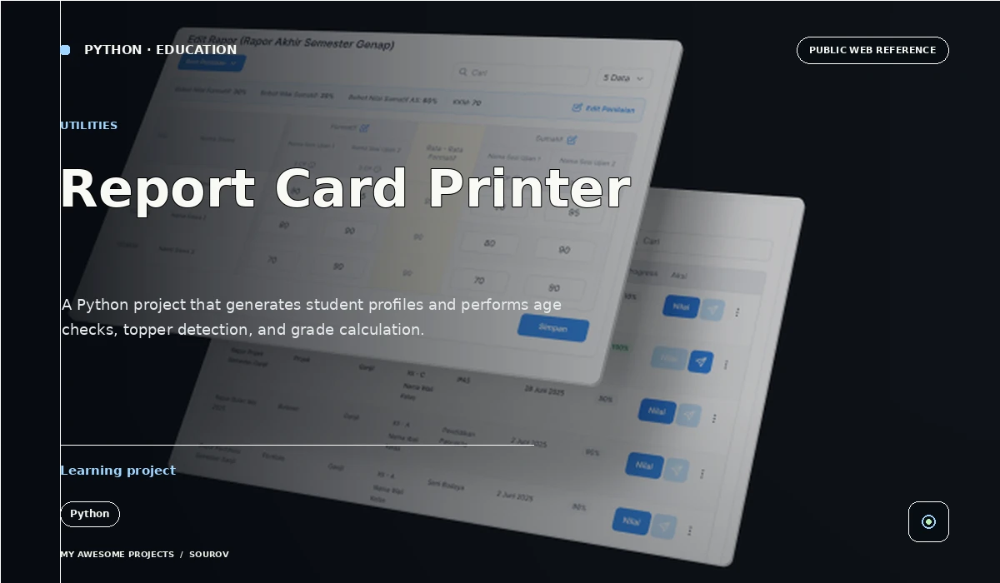</a></td>
<td valign="top"><strong><a href="https://github.com/itssourov13/Report-card-printer">Report Card Printer</a></strong> Learning project A Python project that generates student profiles and performs age checks, topper detection, and grade calculation. <code>Python</code> <a href="https://github.com/itssourov13/Report-card-printer">Public source ↗</a></td>
</tr>
<tr>
<td width="190" valign="top"><a href="https://github.com/itssourov13/-Travel-Weather-Planner-Smart-Commute-Decision-System-Python-">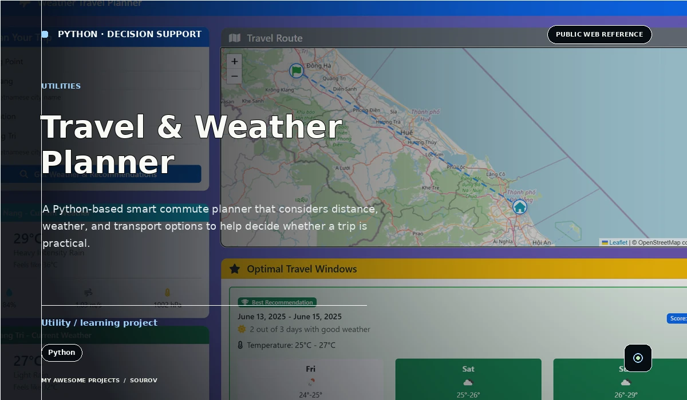</a></td>
<td valign="top"><strong><a href="https://github.com/itssourov13/-Travel-Weather-Planner-Smart-Commute-Decision-System-Python-">Travel &amp; Weather Planner</a></strong> Utility / learning project A Python-based smart commute planner that considers distance, weather, and transport options to help decide whether a trip is practical. <code>Python</code> <a href="https://github.com/itssourov13/-Travel-Weather-Planner-Smart-Commute-Decision-System-Python-">Public source ↗</a></td>
</tr>
</table>

### Writing & Publishing

1 project &nbsp;·&nbsp; <a href="#the-archive">Back to archive index ↑</a>

<table width="100%">
<tr>
<td width="190" valign="top"></td>
<td valign="top"><strong><a href="https://blog-itssourov13.vercel.app">Security &amp; Engineering Notes</a></strong> ★ Live preview listed A technical publication covering security research, engineering experiments, reverse engineering, and lessons learned while building systems. <code>Next.js</code> <code>TypeScript</code> <code>MDX</code> <code>Tailwind CSS</code> <a href="https://blog-itssourov13.vercel.app"><strong>Live preview ↗</strong></a> &nbsp;·&nbsp; <a href="https://github.com/itssourov13/blog">Public source ↗</a></td>
</tr>
</table>

### Open Source

3 projects &nbsp;·&nbsp; <a href="#the-archive">Back to archive index ↑</a>

<table width="100%">
<tr>
<td width="190" valign="top"><a href="https://github.com/itssourov13/awesome">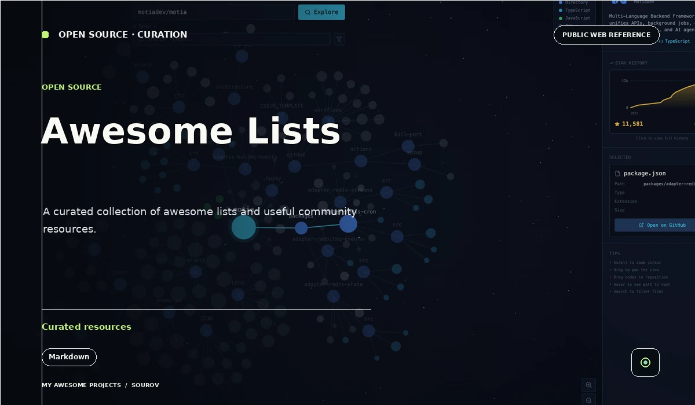</a></td>
<td valign="top"><strong><a href="https://github.com/itssourov13/awesome">Awesome Lists</a></strong> Curated resources A curated collection of awesome lists and useful community resources. <code>Markdown</code> <a href="https://github.com/itssourov13/awesome">Public source ↗</a></td>
</tr>
<tr>
<td width="190" valign="top"><a href="https://itssourov13.github.io/itssourov13/">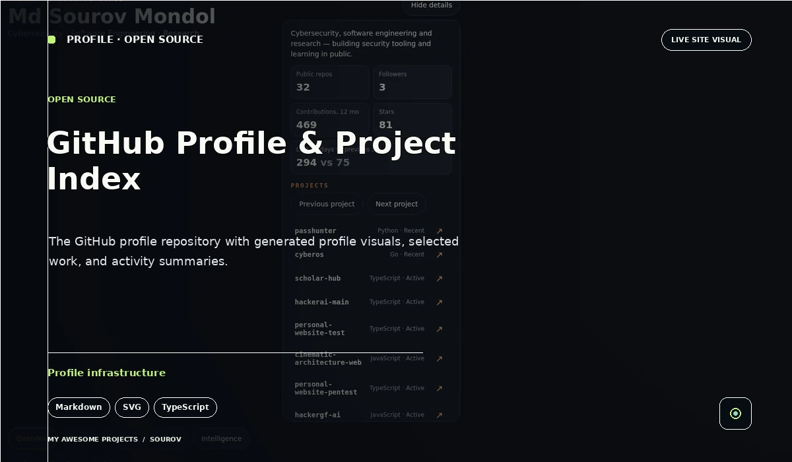</a></td>
<td valign="top"><strong><a href="https://itssourov13.github.io/itssourov13/">GitHub Profile &amp; Project Index</a></strong> Profile infrastructure The GitHub profile repository with generated profile visuals, selected work, and activity summaries. <code>Markdown</code> <code>SVG</code> <code>TypeScript</code> <a href="https://itssourov13.github.io/itssourov13/"><strong>Live preview ↗</strong></a> &nbsp;·&nbsp; <a href="https://github.com/itssourov13/itssourov13">Public source ↗</a></td>
</tr>
<tr>
<td width="190" valign="top"><a href="https://js.org">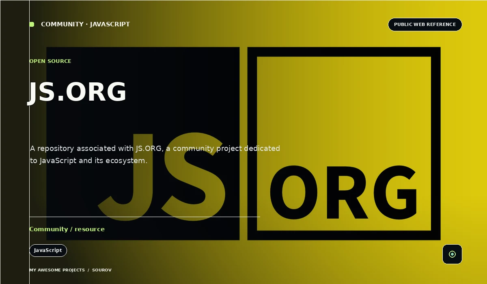</a></td>
<td valign="top"><strong><a href="https://js.org">JS.ORG</a></strong> Community / resource A repository associated with JS.ORG, a community project dedicated to JavaScript and its ecosystem. <code>JavaScript</code> <a href="https://js.org"><strong>Live preview ↗</strong></a> &nbsp;·&nbsp; <a href="https://github.com/itssourov13/js.org">Public source ↗</a></td>
</tr>
</table>

---

## Source privacy & live preview policy

Private repository code is not mirrored here. For a source-hidden entry, the catalog keeps <code>sourceUrl</code> empty; no source button or source link is generated. Its public live URL may still be displayed independently after anonymous access and deployment safety are verified.

For deliberately vulnerable labs, internal dashboards, or systems containing real data, do not publish a preview until isolation, synthetic data, access controls and exposed routes have been reviewed.

<a href="https://itssourov13.github.io/my-awesome-projects/"><strong>Explore the full interactive showcase ↗</strong></a> &nbsp;·&nbsp; <a href="https://github.com/itssourov13">GitHub profile ↗</a>

<strong>Browse:</strong> <a href="#cybersecurity">Cybersecurity</a>&nbsp;8 &nbsp;·&nbsp; <a href="#ai--developer-tools">AI &amp; Developer Tools</a>&nbsp;4 &nbsp;·&nbsp; <a href="#web-apps">Web Apps</a>&nbsp;5 &nbsp;·&nbsp; <a href="#creative--3d">Creative &amp; 3D</a>&nbsp;6 &nbsp;·&nbsp; <a href="#mobile-apps">Mobile Apps</a>&nbsp;2 &nbsp;·&nbsp; <a href="#utilities">Utilities</a>&nbsp;4 &nbsp;·&nbsp; <a href="#writing--publishing">Writing &amp; Publishing</a>&nbsp;1 &nbsp;·&nbsp; <a href="#open-source">Open Source</a>&nbsp;3

<a href="docs/PRIVATE_PROJECTS.md">Private-project policy</a> · <a href="docs/ASSET_GUIDELINES.md">Asset guidelines</a> · <a href="docs/PROJECT_CATALOG.md">Catalog notes</a> · <a href="docs/SITE.md">Website guide</a>

© 2026 itssourov13 · 33 projects · 15 live previews · 32 public sources · Latest catalog update: 2026-10-30

Catalog source: projects.json · README generated by scripts/generate_readme.py · Public repository sync never imports private repository metadata.

<!-- GENERATED SHOWCASE:END -->
