<!-- GENERATED SHOWCASE:BEGIN -->

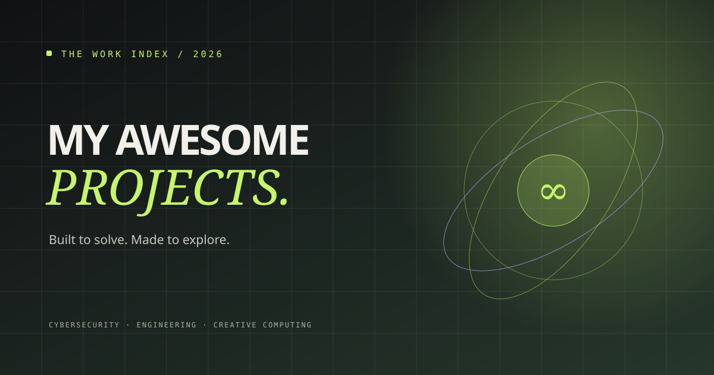

<h1>My Awesome Projects</h1>

<strong>A visual archive of software, security tooling, product experiments and creative computing.</strong>

<a href="https://itssourov13.github.io/my-awesome-projects/">Open the interactive showcase ↗</a> &nbsp;·&nbsp; <a href="https://github.com/itssourov13">GitHub profile ↗</a>

> **32 projects** &nbsp;·&nbsp; **8 disciplines** &nbsp;·&nbsp; **31 public sources** &nbsp;·&nbsp; **14 live previews**

This README is the **main project showcase**. The companion website provides search, category filters, sorting, detail views and a visual gallery.

## How to explore

- **Public projects** link to their public source repository when that source is verified.
- **Private or unpublished projects** can show approved descriptions and graphics without a source link.
- **Live previews are separate from source visibility.** A preview is listed only when its HTTPS URL is approved for public visitors.
- Covers and feature panels are portfolio artwork, not claims that every feature is production-ready or real UI screenshots.

## Selected work

<table width="100%">
<tr><td width="50%" valign="top" style="padding:14px;">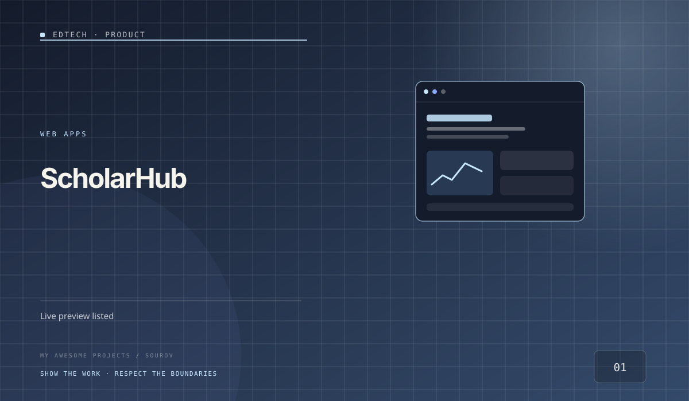<h3><a href="https://scholarhub-test.vercel.app/">ScholarHub</a></h3>
<strong>Web Apps</strong> &nbsp;·&nbsp; <code>Live preview listed</code>

A scholarship discovery and application-management platform designed to help students find opportunities and manage application progress.

<strong>Stack:</strong> TypeScript · Web

<a href="https://scholarhub-test.vercel.app/">Live preview ↗</a> &nbsp;·&nbsp; <em>Source hidden</em>
</td><td width="50%" valign="top" style="padding:14px;">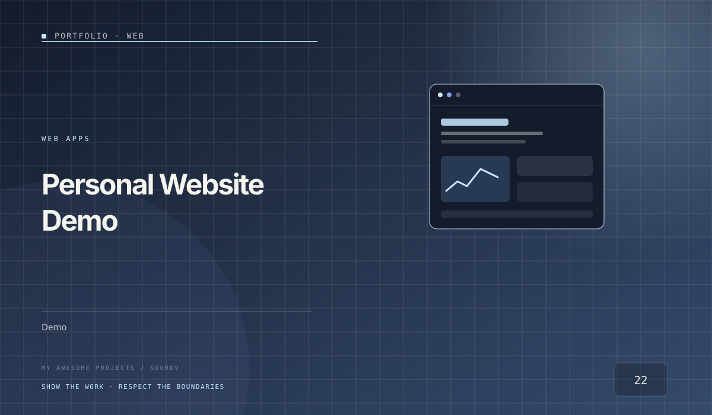<h3><a href="https://demo-website-itssourov13.vercel.app/">Personal Website Demo</a></h3>
<strong>Web Apps</strong> &nbsp;·&nbsp; <code>Demo</code>

A Next.js personal-website demo focused on presenting profile content, projects, and a modern responsive web experience.

<strong>Stack:</strong> Next.js · TypeScript · React

<a href="https://demo-website-itssourov13.vercel.app/">Live preview ↗</a> &nbsp;·&nbsp; <a href="https://github.com/itssourov13/personal-website-test">Public source ↗</a>
</td></tr>
<tr><td width="50%" valign="top" style="padding:14px;"><h3><a href="https://kaven-itssourov13.vercel.app/">The Glass Pavilion</a></h3>
<strong>Creative &amp; 3D</strong> &nbsp;·&nbsp; <code>Live preview listed</code>

A cinematic architectural website experiment combining immersive imagery, editorial typography, and scroll-driven motion.

<strong>Stack:</strong> JavaScript · GSAP · Lenis · Three.js

<a href="https://kaven-itssourov13.vercel.app/">Live preview ↗</a> &nbsp;·&nbsp; <a href="https://github.com/itssourov13/cinematic-architecture-web">Public source ↗</a>
</td><td width="50%" valign="top" style="padding:14px;">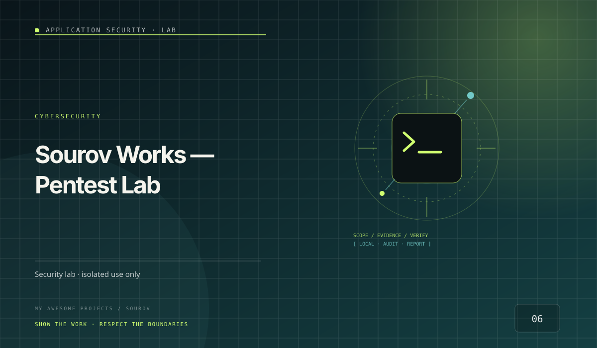<h3><a href="https://github.com/itssourov13/personal-website-pentest">Sourov Works — Pentest Lab</a></h3>
<strong>Cybersecurity</strong> &nbsp;·&nbsp; <code>Security lab · isolated use only</code>

A deliberately vulnerable full-stack web application for hands-on penetration testing, vulnerability research, and security-assessment practice.

<strong>Stack:</strong> Next.js · TypeScript · PostgreSQL / PGlite · Playwright

<a href="https://github.com/itssourov13/personal-website-pentest">Public source ↗</a>
</td></tr>
<tr><td width="50%" valign="top" style="padding:14px;">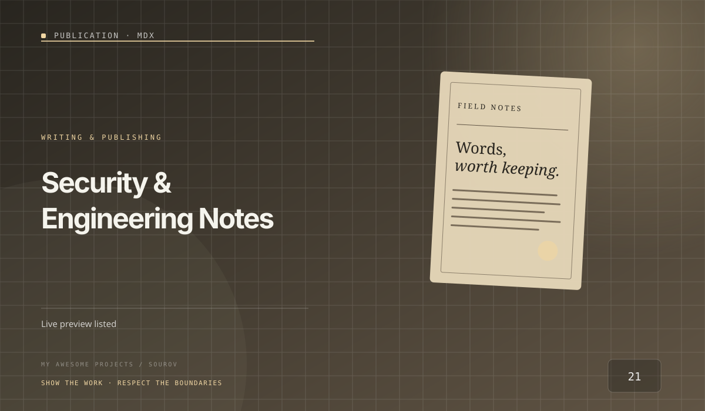<h3><a href="https://blog-itssourov13.vercel.app">Security &amp; Engineering Notes</a></h3>
<strong>Writing &amp; Publishing</strong> &nbsp;·&nbsp; <code>Live preview listed</code>

A technical publication covering security research, engineering experiments, reverse engineering, and lessons learned while building systems.

<strong>Stack:</strong> Next.js · TypeScript · MDX · Tailwind CSS

<a href="https://blog-itssourov13.vercel.app">Live preview ↗</a> &nbsp;·&nbsp; <a href="https://github.com/itssourov13/blog">Public source ↗</a>
</td><td width="50%" valign="top" style="padding:14px;">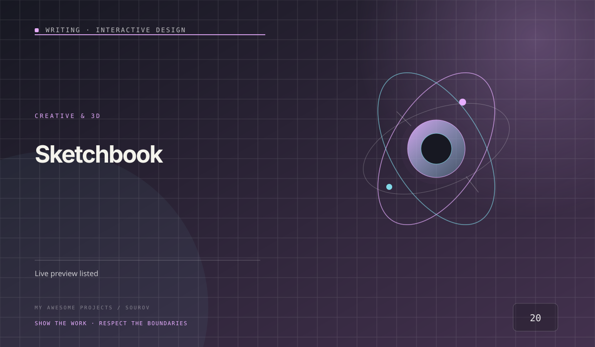<h3><a href="https://sketchbook-itssourov13.vercel.app/">Sketchbook</a></h3>
<strong>Creative &amp; 3D</strong> &nbsp;·&nbsp; <code>Live preview listed</code>

A poetic writing space for poems, prose, fragments, notes, and a tactile visual sketchbook.

<strong>Stack:</strong> Astro · JavaScript · CSS

<a href="https://sketchbook-itssourov13.vercel.app/">Live preview ↗</a> &nbsp;·&nbsp; <a href="https://github.com/itssourov13/sketchbook">Public source ↗</a>
</td></tr>
</table>

## Complete project archive

Public-source entries: 31 · Source-hidden entries: 1 · Latest recorded project update in the catalog: 2026-10-25.

### Cybersecurity

<table width="100%">
<tr><td width="50%" valign="top" style="padding:14px;">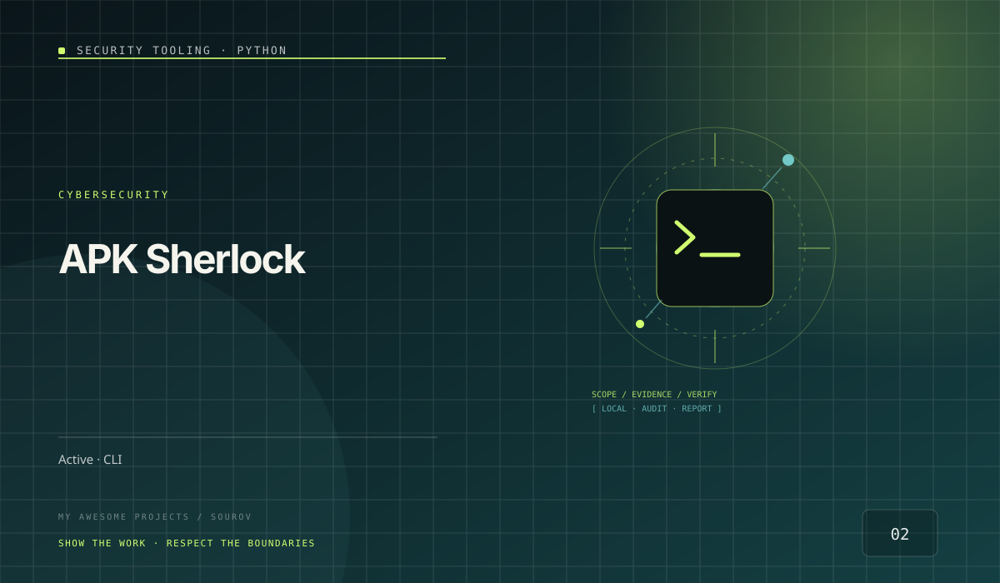<h3><a href="https://github.com/itssourov13/apk-sherlock">APK Sherlock</a></h3>
<strong>Cybersecurity</strong> &nbsp;·&nbsp; <code>Active · CLI</code>

An offline-first Android APK static-analysis CLI for permissions, components, signing metadata, URLs, suspicious strings, SDK indicators, and explainable risk reports.

<strong>Stack:</strong> Python 3.11+ · SQLite · CLI

<a href="https://github.com/itssourov13/apk-sherlock">Public source ↗</a>
</td><td width="50%" valign="top" style="padding:14px;">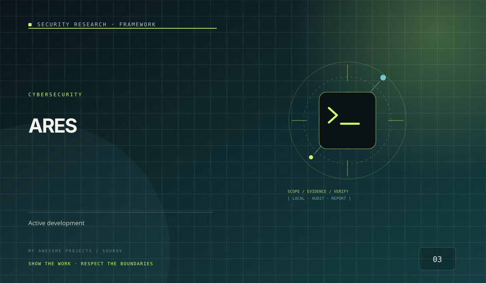<h3><a href="https://github.com/itssourov13/ares">ARES</a></h3>
<strong>Cybersecurity</strong> &nbsp;·&nbsp; <code>Active development</code>

An AI-assisted security assessment orchestration framework for authorized reconnaissance, vulnerability analysis, evidence collection, and reporting.

<strong>Stack:</strong> Python · AI agents · Security automation

<a href="https://github.com/itssourov13/ares">Public source ↗</a>
</td></tr>
<tr><td width="50%" valign="top" style="padding:14px;"><h3><a href="https://github.com/itssourov13/cyberos">CYBEROS</a></h3>
<strong>Cybersecurity</strong> &nbsp;·&nbsp; <code>In development</code>

A Go-first modular security operations platform and control plane for authorized security work, with grants, brokered execution, workers, and audit-oriented boundaries.

<strong>Stack:</strong> Go · PostgreSQL · React

<a href="https://github.com/itssourov13/cyberos">Public source ↗</a>
</td><td width="50%" valign="top" style="padding:14px;">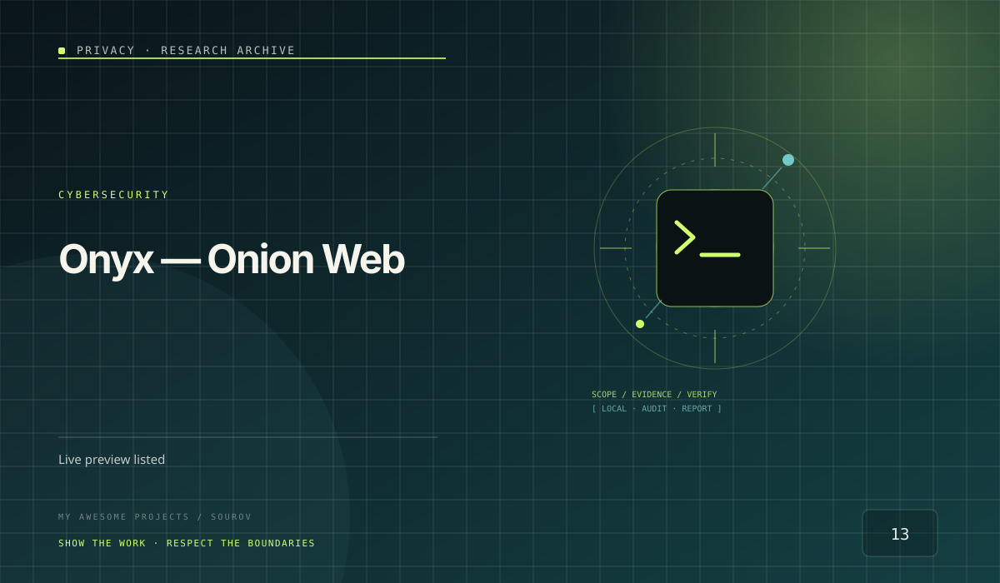<h3><a href="https://onyx-xi-three.vercel.app">Onyx — Onion Web</a></h3>
<strong>Cybersecurity</strong> &nbsp;·&nbsp; <code>Live preview listed</code>

A privacy-first research archive for security, privacy, intelligence, and network observability.

<strong>Stack:</strong> TypeScript · Web

<a href="https://onyx-xi-three.vercel.app">Live preview ↗</a> &nbsp;·&nbsp; <a href="https://github.com/itssourov13/onyx">Public source ↗</a>
</td></tr>
<tr><td width="50%" valign="top" style="padding:14px;">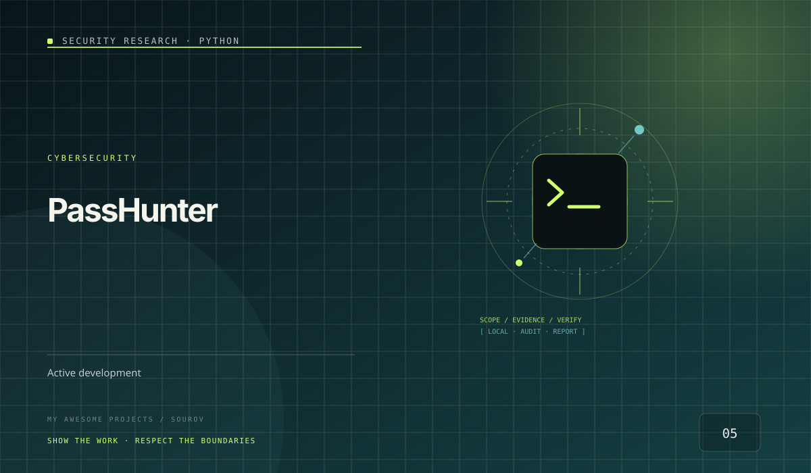<h3><a href="https://github.com/itssourov13/passhunter">PassHunter</a></h3>
<strong>Cybersecurity</strong> &nbsp;·&nbsp; <code>Active development</code>

A deterministic password-pattern candidate generator for authorized security assessments, CTFs, and lab research.

<strong>Stack:</strong> Python · CLI · Standard library

<a href="https://github.com/itssourov13/passhunter">Public source ↗</a>
</td><td width="50%" valign="top" style="padding:14px;">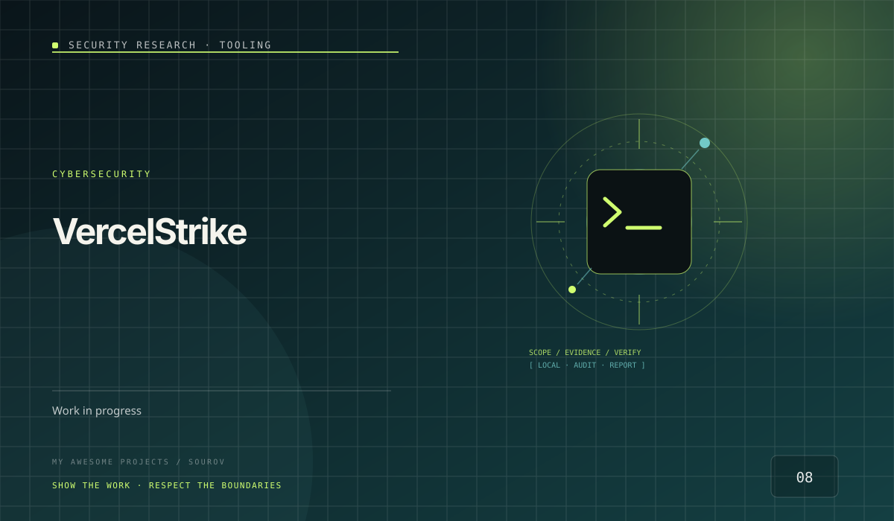<h3><a href="https://github.com/itssourov13/VercelStrike">VercelStrike</a></h3>
<strong>Cybersecurity</strong> &nbsp;·&nbsp; <code>Work in progress</code>

A work-in-progress security assessment framework for Vercel and Next.js applications.

<strong>Stack:</strong> Python · Security testing

<a href="https://github.com/itssourov13/VercelStrike">Public source ↗</a>
</td></tr>
<tr><td width="50%" valign="top" style="padding:14px;">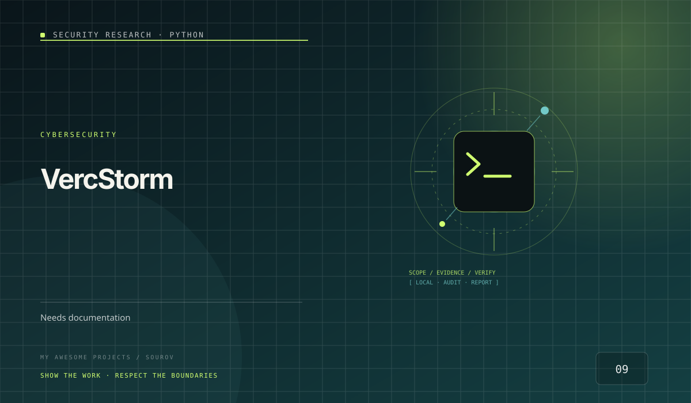<h3><a href="https://github.com/itssourov13/VercStorm">VercStorm</a></h3>
<strong>Cybersecurity</strong> &nbsp;·&nbsp; <code>Needs documentation</code>

A Python security-research repository in the Vercel/Next.js assessment space; project details remain to be curated.

<strong>Stack:</strong> Python

<a href="https://github.com/itssourov13/VercStorm">Public source ↗</a>
</td><td width="50%" valign="top"></td></tr>
</table>

### AI & Developer Tools

<table width="100%">
<tr><td width="50%" valign="top" style="padding:14px;">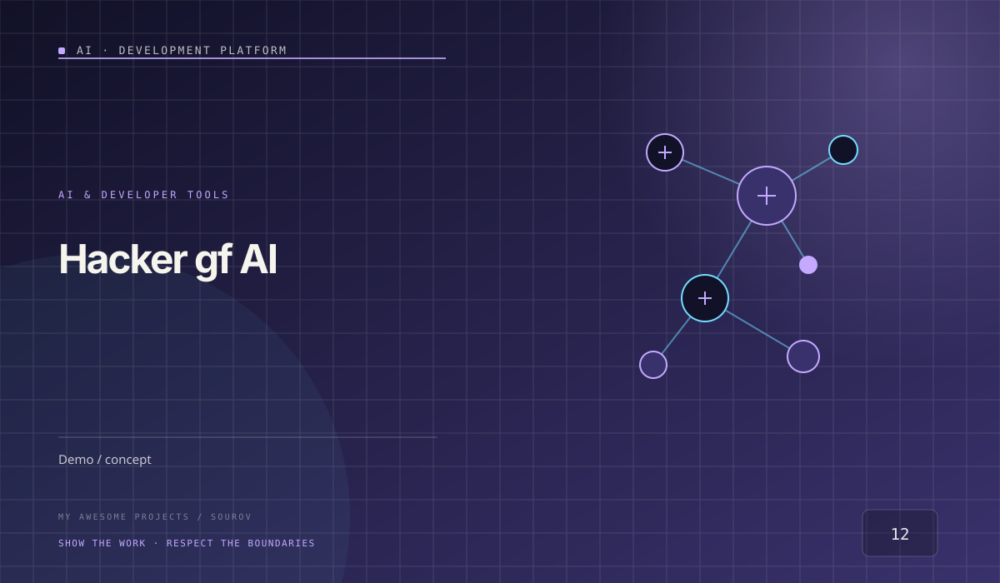<h3><a href="https://hackergf-ai.vercel.app">Hacker gf AI</a></h3>
<strong>AI &amp; Developer Tools</strong> &nbsp;·&nbsp; <code>Demo / concept</code>

A hacker-themed AI development-platform interface concept for chat, code editing, sandboxed execution, and file management.

<strong>Stack:</strong> JavaScript · React · AI

<a href="https://hackergf-ai.vercel.app">Live preview ↗</a> &nbsp;·&nbsp; <a href="https://github.com/itssourov13/hackergf-ai">Public source ↗</a>
</td><td width="50%" valign="top" style="padding:14px;">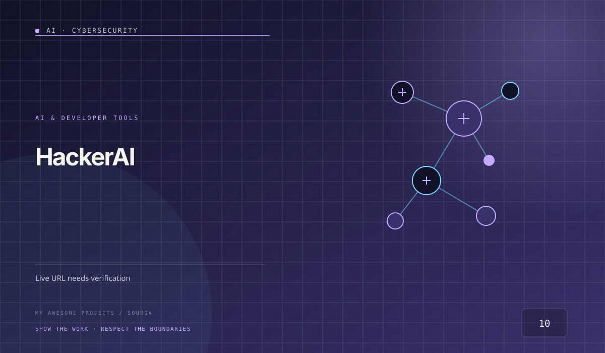<h3><a href="https://github.com/itssourov13/hackerai-main">HackerAI</a></h3>
<strong>AI &amp; Developer Tools</strong> &nbsp;·&nbsp; <code>Live URL needs verification</code>

An AI-powered penetration-testing assistant concept with agent workflows and a modern full-stack application architecture.

<strong>Stack:</strong> TypeScript · Next.js · AI

<a href="https://github.com/itssourov13/hackerai-main">Public source ↗</a>
</td></tr>
<tr><td width="50%" valign="top" style="padding:14px;">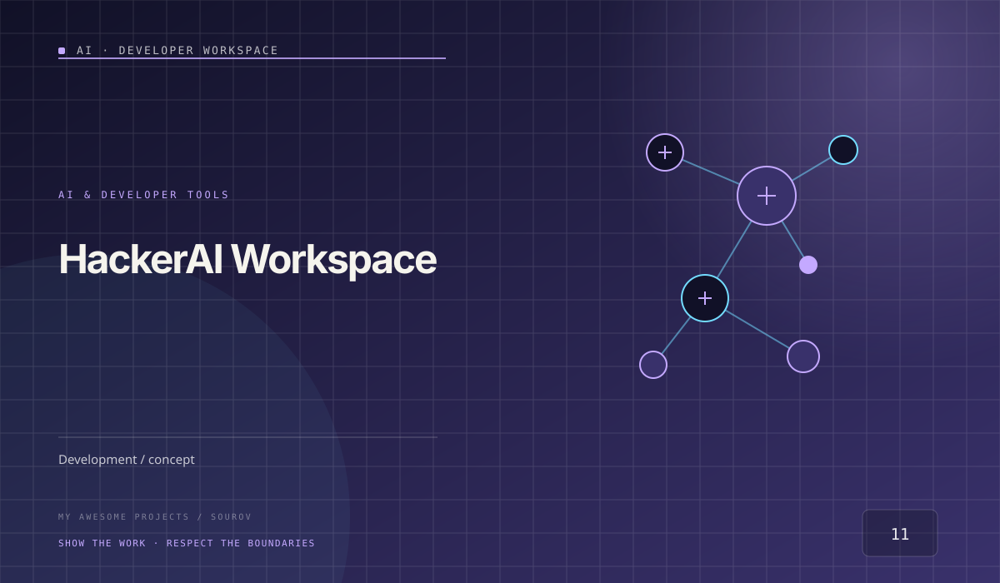<h3><a href="https://github.com/itssourov13/hackerai-base44">HackerAI Workspace</a></h3>
<strong>AI &amp; Developer Tools</strong> &nbsp;·&nbsp; <code>Development / concept</code>

An AI-powered developer workspace concept for building, coding, chatting, and deploying from a unified interface.

<strong>Stack:</strong> TypeScript · React · Next.js

<a href="https://github.com/itssourov13/hackerai-base44">Public source ↗</a>
</td><td width="50%" valign="top" style="padding:14px;">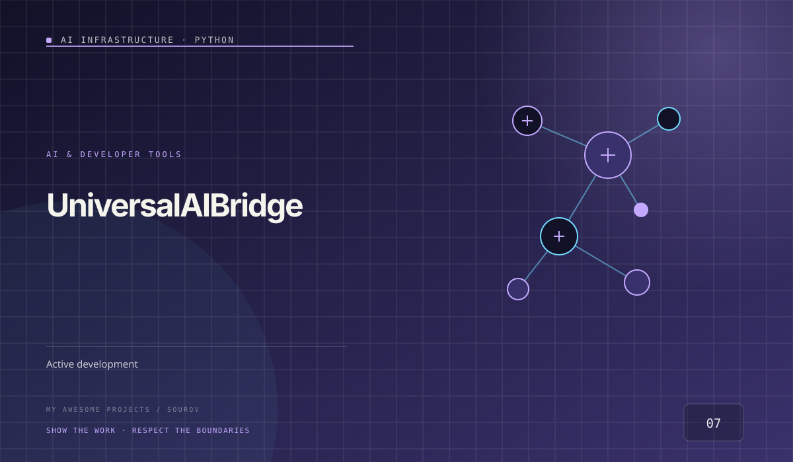<h3><a href="https://github.com/itssourov13/uab">UniversalAIBridge</a></h3>
<strong>AI &amp; Developer Tools</strong> &nbsp;·&nbsp; <code>Active development</code>

An API-compatible bridge between AI agents and web-based AI sessions, with a control plane for tasks, approvals, events, and project management.

<strong>Stack:</strong> Python · AI agents · API

<a href="https://github.com/itssourov13/uab">Public source ↗</a>
</td></tr>
</table>

### Web Apps

<table width="100%">
<tr><td width="50%" valign="top" style="padding:14px;">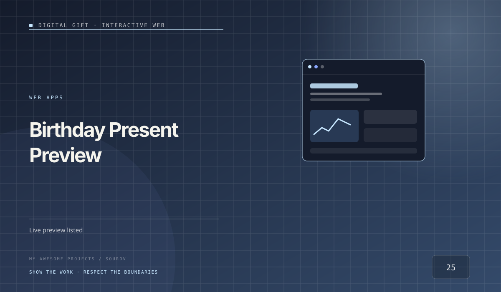<h3><a href="https://birthday-present-itssourov13.vercel.app/">Birthday Present Preview</a></h3>
<strong>Web Apps</strong> &nbsp;·&nbsp; <code>Live preview listed</code>

A self-hostable interactive birthday-gift experience featuring 3D animations, memories, mini-games, and a personal letter.

<strong>Stack:</strong> JavaScript · Web · Vercel

<a href="https://birthday-present-itssourov13.vercel.app/">Live preview ↗</a> &nbsp;·&nbsp; <a href="https://github.com/itssourov13/birthday-present-preview">Public source ↗</a>
</td><td width="50%" valign="top" style="padding:14px;">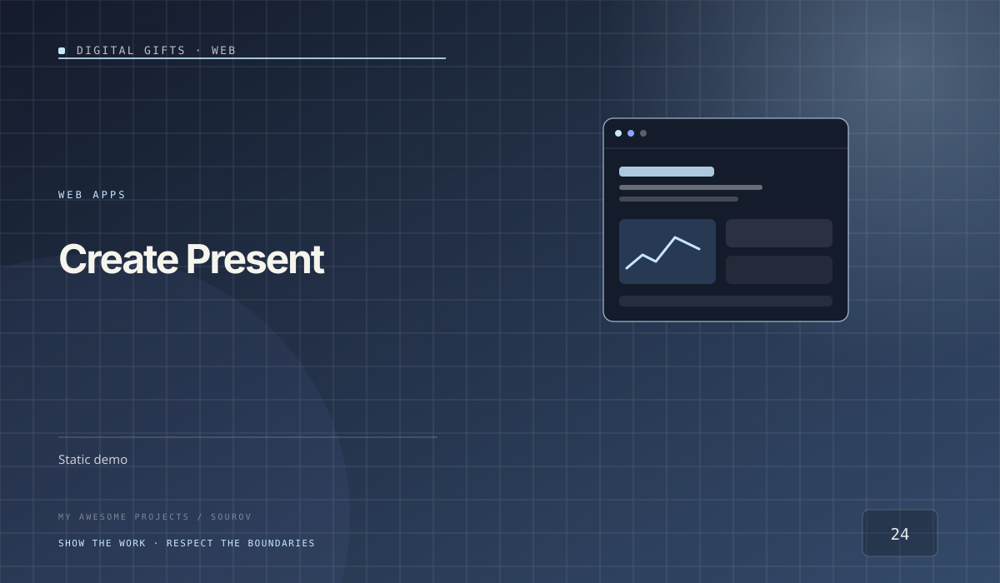<h3><a href="https://cgw-itssourov13.vercel.app">Create Present</a></h3>
<strong>Web Apps</strong> &nbsp;·&nbsp; <code>Static demo</code>

An open-source static gift-website reconstruction/demo for personalized digital gifts for birthdays, anniversaries, and special moments.

<strong>Stack:</strong> HTML · JavaScript · Vercel

<a href="https://cgw-itssourov13.vercel.app">Live preview ↗</a> &nbsp;·&nbsp; <a href="https://github.com/itssourov13/create-present-website">Public source ↗</a>
</td></tr>
<tr><td width="50%" valign="top" style="padding:14px;">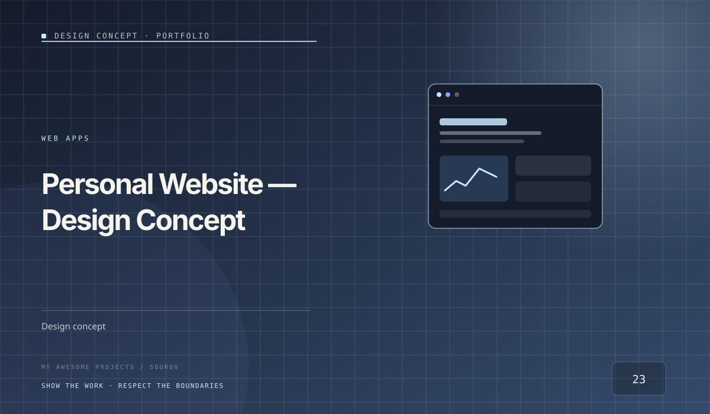<h3><a href="https://claude-personal-web-itssourov13.vercel.app/">Personal Website — Design Concept</a></h3>
<strong>Web Apps</strong> &nbsp;·&nbsp; <code>Design concept</code>

A premium personal-website design concept exploring editorial positioning, product-design services, and a polished portfolio layout.

<strong>Stack:</strong> Next.js · TypeScript · React

<a href="https://claude-personal-web-itssourov13.vercel.app/">Live preview ↗</a> &nbsp;·&nbsp; <a href="https://github.com/itssourov13/claude-personal-website">Public source ↗</a>
</td><td width="50%" valign="top"></td></tr>
</table>

### Creative & 3D

<table width="100%">
<tr><td width="50%" valign="top" style="padding:14px;">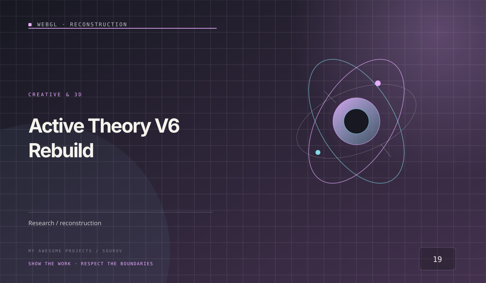<h3><a href="https://github.com/itssourov13/active-theory">Active Theory V6 Rebuild</a></h3>
<strong>Creative &amp; 3D</strong> &nbsp;·&nbsp; <code>Research / reconstruction</code>

A reconstruction workspace researching an immersive WebGL web experience and documenting visual-parity verification.

<strong>Stack:</strong> GLSL · WebGL · JavaScript

<a href="https://github.com/itssourov13/active-theory">Public source ↗</a>
</td><td width="50%" valign="top" style="padding:14px;">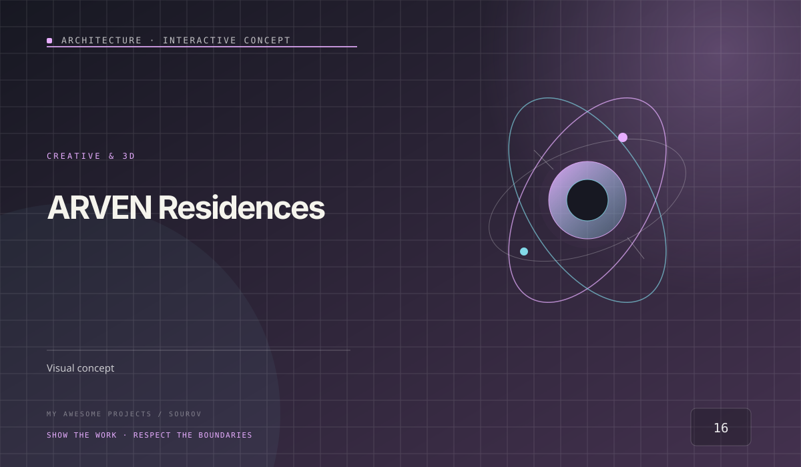<h3><a href="https://arven-itssourov13.vercel.app/">ARVEN Residences</a></h3>
<strong>Creative &amp; 3D</strong> &nbsp;·&nbsp; <code>Visual concept</code>

A cinematic luxury real-estate landing-page concept for a fictional Dubai waterfront residence, built around light, water, and space.

<strong>Stack:</strong> JavaScript · GSAP · Lenis · Three.js

<a href="https://arven-itssourov13.vercel.app/">Live preview ↗</a> &nbsp;·&nbsp; <a href="https://github.com/itssourov13/arven">Public source ↗</a>
</td></tr>
<tr><td width="50%" valign="top" style="padding:14px;">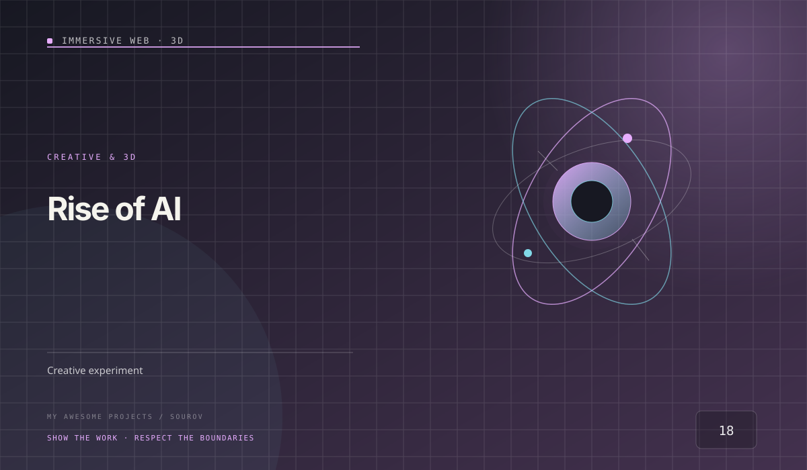<h3><a href="https://github.com/itssourov13/rise-of-ai">Rise of AI</a></h3>
<strong>Creative &amp; 3D</strong> &nbsp;·&nbsp; <code>Creative experiment</code>

A cinematic 3D interactive journey through the evolution of artificial intelligence.

<strong>Stack:</strong> Next.js · React · Three.js · GSAP · WebGL

<a href="https://github.com/itssourov13/rise-of-ai">Public source ↗</a>
</td><td width="50%" valign="top" style="padding:14px;">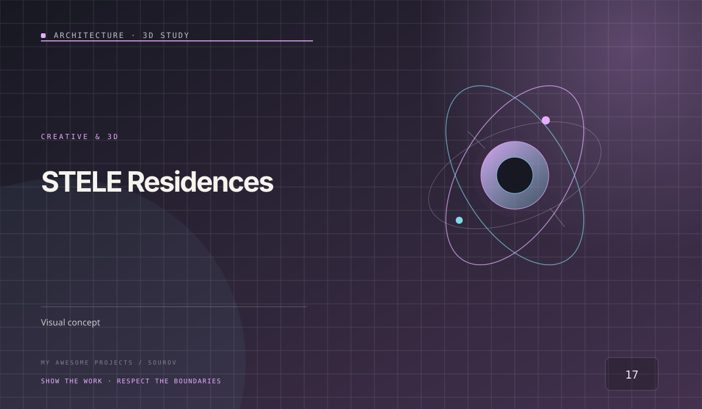<h3><a href="https://stele-residences-itssourov13.vercel.app">STELE Residences</a></h3>
<strong>Creative &amp; 3D</strong> &nbsp;·&nbsp; <code>Visual concept</code>

An immersive architectural website concept exploring stone, smoked glass, light, a custom interactive tower, and editorial motion.

<strong>Stack:</strong> JavaScript · Three.js · WebGL

<a href="https://stele-residences-itssourov13.vercel.app">Live preview ↗</a> &nbsp;·&nbsp; <a href="https://github.com/itssourov13/stele-residences">Public source ↗</a>
</td></tr>
</table>

### Mobile Apps

<table width="100%">
<tr><td width="50%" valign="top" style="padding:14px;">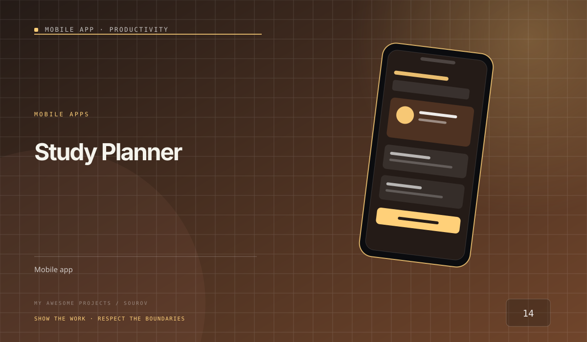<h3><a href="https://github.com/itssourov13/study-planner-apk">Study Planner</a></h3>
<strong>Mobile Apps</strong> &nbsp;·&nbsp; <code>Mobile app</code>

An offline-first study planner built with React Native and Expo for tasks, study schedules, goals, notes, and progress statistics.

<strong>Stack:</strong> React Native · Expo · TypeScript

<a href="https://github.com/itssourov13/study-planner-apk">Public source ↗</a>
</td><td width="50%" valign="top"></td></tr>
</table>

### Utilities

<table width="100%">
<tr><td width="50%" valign="top" style="padding:14px;">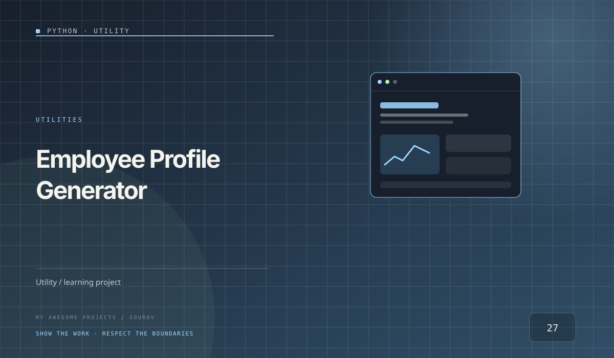<h3><a href="https://github.com/itssourov13/Employee-profile-generator">Employee Profile Generator</a></h3>
<strong>Utilities</strong> &nbsp;·&nbsp; <code>Utility / learning project</code>

A Python tool for generating employee profiles with salary analysis, role information, and code breakdown features.

<strong>Stack:</strong> Python

<a href="https://github.com/itssourov13/Employee-profile-generator">Public source ↗</a>
</td><td width="50%" valign="top" style="padding:14px;">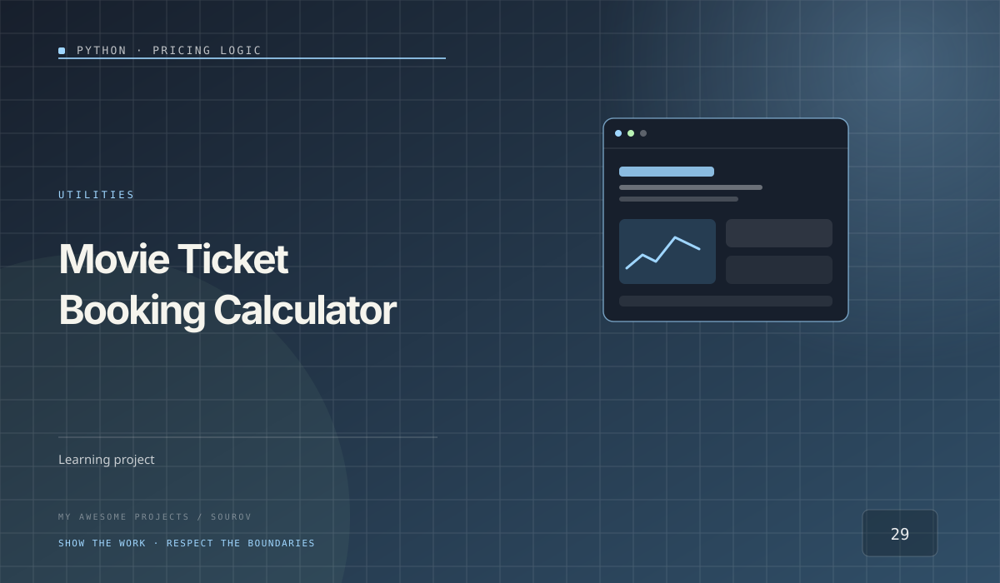<h3><a href="https://github.com/itssourov13/Movie-Ticket-Booking-Calculator-Python-">Movie Ticket Booking Calculator</a></h3>
<strong>Utilities</strong> &nbsp;·&nbsp; <code>Learning project</code>

A Python calculator for ticket prices based on age, seat type, show time, discounts, and extra charges.

<strong>Stack:</strong> Python

<a href="https://github.com/itssourov13/Movie-Ticket-Booking-Calculator-Python-">Public source ↗</a>
</td></tr>
<tr><td width="50%" valign="top" style="padding:14px;">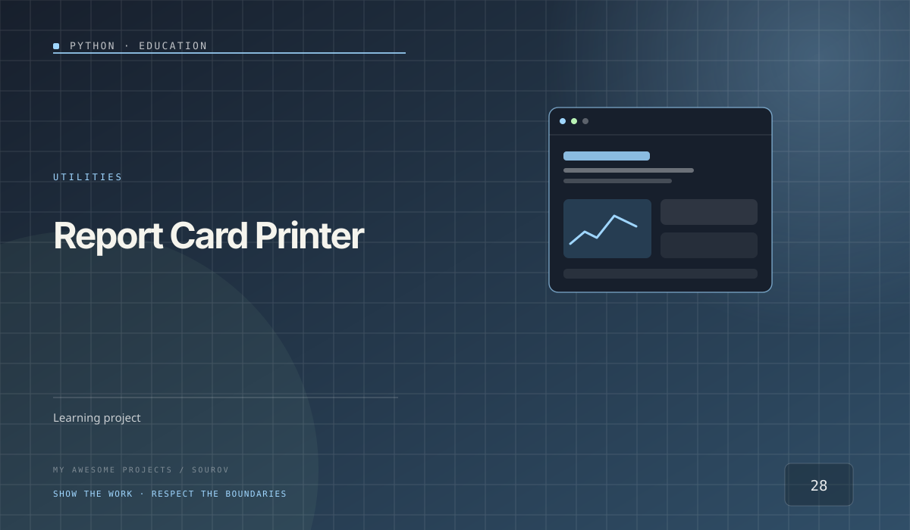<h3><a href="https://github.com/itssourov13/Report-card-printer">Report Card Printer</a></h3>
<strong>Utilities</strong> &nbsp;·&nbsp; <code>Learning project</code>

A Python project that generates student profiles and performs age checks, topper detection, and grade calculation.

<strong>Stack:</strong> Python

<a href="https://github.com/itssourov13/Report-card-printer">Public source ↗</a>
</td><td width="50%" valign="top" style="padding:14px;">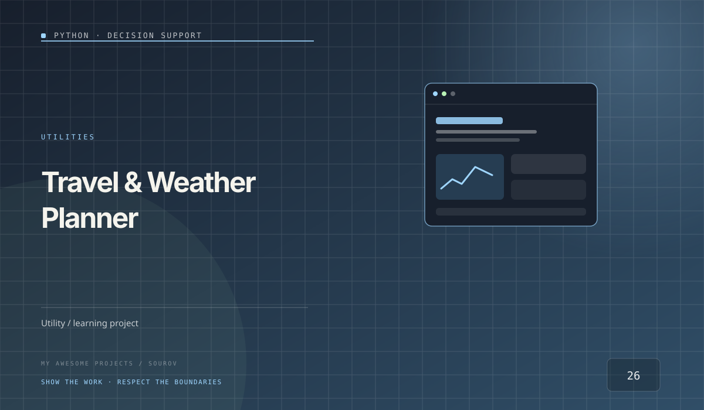<h3><a href="https://github.com/itssourov13/-Travel-Weather-Planner-Smart-Commute-Decision-System-Python-">Travel &amp; Weather Planner</a></h3>
<strong>Utilities</strong> &nbsp;·&nbsp; <code>Utility / learning project</code>

A Python-based smart commute planner that considers distance, weather, and transport options to help decide whether a trip is practical.

<strong>Stack:</strong> Python

<a href="https://github.com/itssourov13/-Travel-Weather-Planner-Smart-Commute-Decision-System-Python-">Public source ↗</a>
</td></tr>
</table>

### Open Source

<table width="100%">
<tr><td width="50%" valign="top" style="padding:14px;">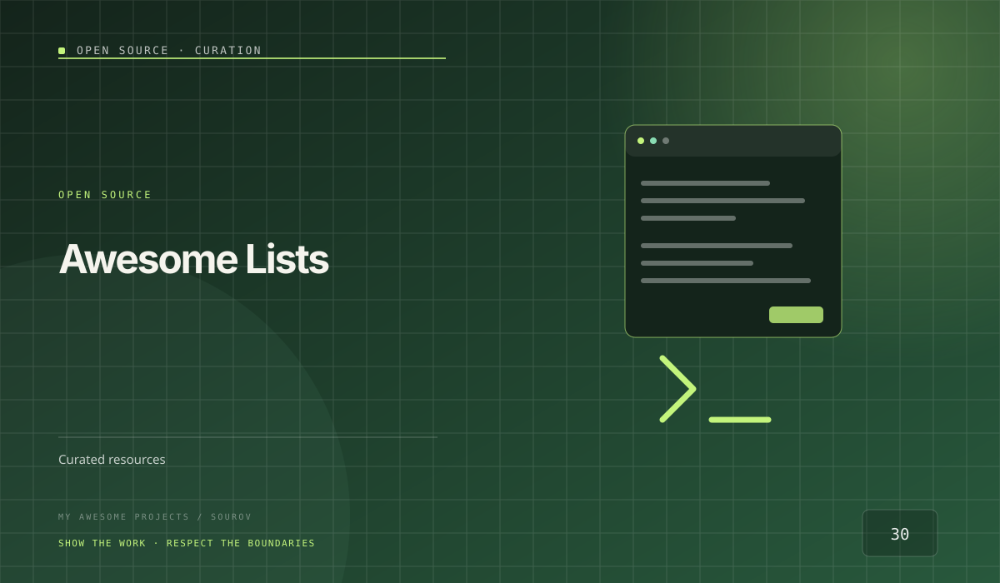<h3><a href="https://github.com/itssourov13/awesome">Awesome Lists</a></h3>
<strong>Open Source</strong> &nbsp;·&nbsp; <code>Curated resources</code>

A curated collection of awesome lists and useful community resources.

<strong>Stack:</strong> Markdown

<a href="https://github.com/itssourov13/awesome">Public source ↗</a>
</td><td width="50%" valign="top" style="padding:14px;">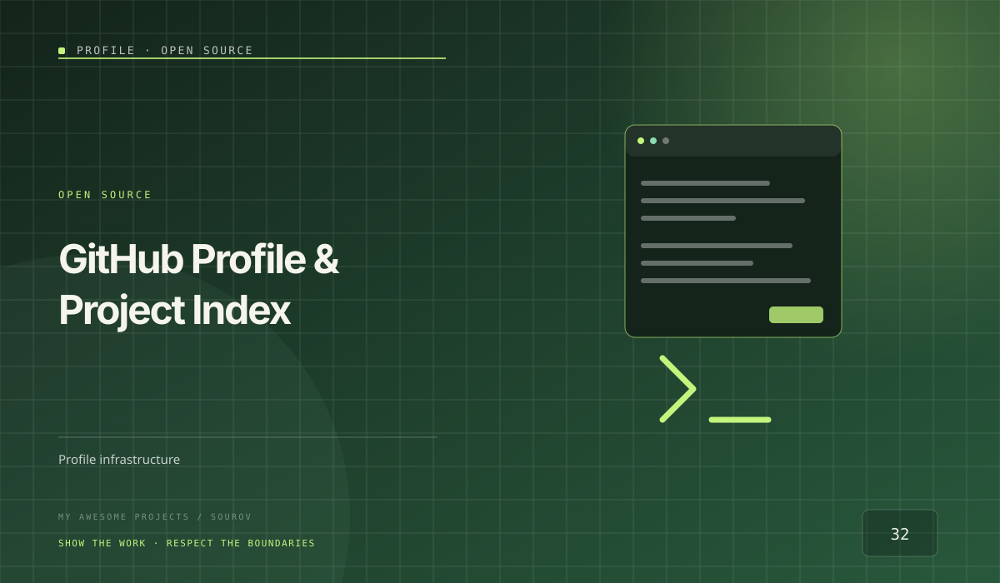<h3><a href="https://itssourov13.github.io/itssourov13/">GitHub Profile &amp; Project Index</a></h3>
<strong>Open Source</strong> &nbsp;·&nbsp; <code>Profile infrastructure</code>

The GitHub profile repository with generated profile visuals, selected work, and activity summaries.

<strong>Stack:</strong> Markdown · SVG · TypeScript

<a href="https://itssourov13.github.io/itssourov13/">Live preview ↗</a> &nbsp;·&nbsp; <a href="https://github.com/itssourov13/itssourov13">Public source ↗</a>
</td></tr>
<tr><td width="50%" valign="top" style="padding:14px;">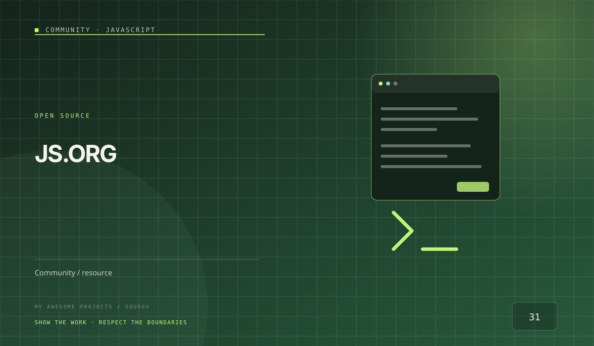<h3><a href="https://js.org">JS.ORG</a></h3>
<strong>Open Source</strong> &nbsp;·&nbsp; <code>Community / resource</code>

A repository associated with JS.ORG, a community project dedicated to JavaScript and its ecosystem.

<strong>Stack:</strong> JavaScript

<a href="https://js.org">Live preview ↗</a> &nbsp;·&nbsp; <a href="https://github.com/itssourov13/js.org">Public source ↗</a>
</td><td width="50%" valign="top"></td></tr>
</table>

## Source privacy & live preview policy

Private repository code is not mirrored here. For a source-hidden entry, the catalog keeps <code>sourceUrl</code> empty; no source button or source link is generated. Its public live URL may still be displayed independently after anonymous access and deployment safety are verified.

For deliberately vulnerable labs, internal dashboards, or systems containing real data, do not publish a preview until isolation, synthetic data, access controls and exposed routes have been reviewed.

<a href="https://itssourov13.github.io/my-awesome-projects/"><strong>Explore the full interactive showcase ↗</strong></a>

Catalog source: projects.json · README generated by scripts/generate_readme.py · Public repository sync never imports private repository metadata.

<a href="docs/PRIVATE_PROJECTS.md">Private-project policy</a> · <a href="docs/ASSET_GUIDELINES.md">Asset guidelines</a> · <a href="docs/PROJECT_CATALOG.md">Catalog notes</a>

<!-- GENERATED SHOWCASE:END -->
